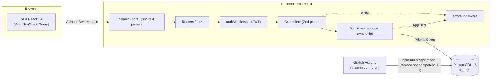
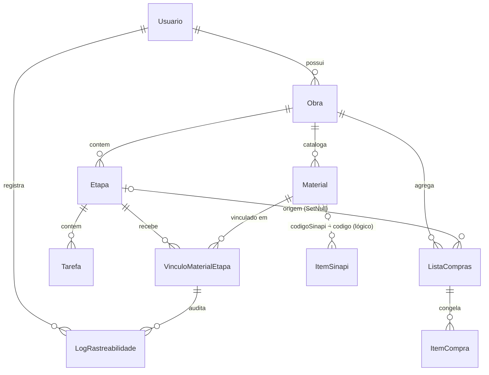
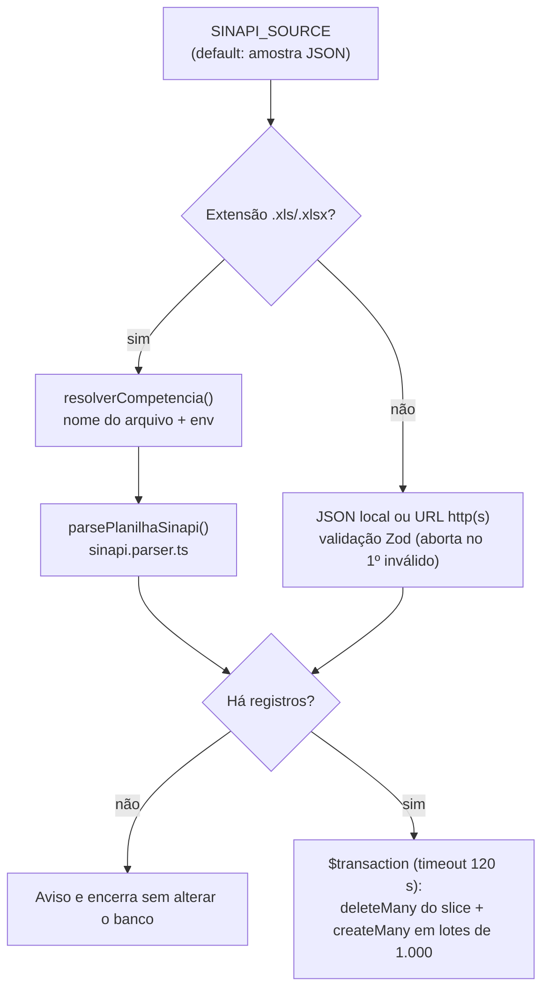
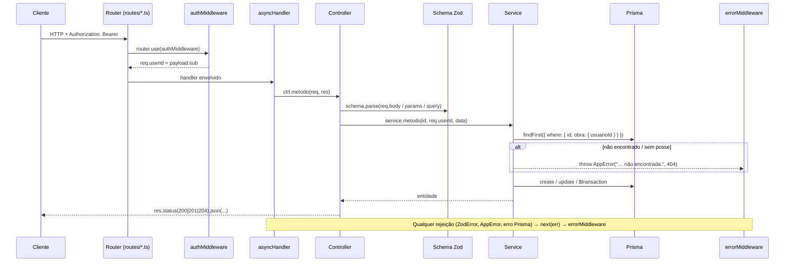

# Build-Plan — Raio-X Arquitetural e Técnico

> **Documento vivo** · Última revisão em 2026-11-01, com base no `main` (commit `19e6936`, pós-merge do PR #19) **mais o trabalho ainda não commitado** da branch `feature-sinapi-fase-2`. Itens que dependem desse trabalho estão marcados com 🚧. Ver [Histórico de revisões](#histórico-de-revisões).
> Objetivo: consolidar decisões, padrões e convenções dos marcos M1–M7 + SINAPI e servir de mapa para as próximas fases.
> Documentos relacionados: [RFC.md](RFC.md) · [marco-m4-consolidacao.md](marco-m4-consolidacao.md) · [marco-m5-consolidacao.md](marco-m5-consolidacao.md) · [frontend-consolidacao.md](frontend-consolidacao.md) · [registro-comparacao.md](registro-comparacao.md)

---

## Sumário executivo

| Dimensão | Resumo |
|---|---|
| **Arquitetura** | Monorepo com dois pacotes independentes (`backend/`, `frontend/`), cada um com `package.json` e lockfile próprios. Sem workspace raiz. |
| **Backend** | API REST em Express 4 + TypeScript (ESM/NodeNext), camadas *schema Zod → controller → service → Prisma*. Autenticação JWT HS256 stateless. |
| **Persistência** | PostgreSQL 16 via Prisma 6. 10 models, 6 enums, 3 migrações. Busca textual SINAPI com `pg_trgm` + índice GIN. |
| **Frontend** | SPA React 19 + Vite 8, TanStack Query 5 para estado de servidor, Context API para sessão e obra ativa, shadcn/ui (Radix) + Tailwind 3. |
| **Testes** | Backend: Jest + Supertest contra **banco real** (sem mocks de Prisma). Frontend: Vitest + Testing Library em jsdom, com mocks da camada `api/`. |
| **CI/CD** | 3 workflows GitHub Actions: backend CI, frontend CI e importação mensal agendada do SINAPI. |
| **Domínio** | Usuário → Obras → Etapas → Tarefas; Materiais (catálogo por obra) vinculados a Etapas com máquina de estados auditada; Listas de Compras como snapshot; catálogo SINAPI de preços de referência. |



---

## 1. Stack Tecnológica e Dependências Principais

### 1.1 Ferramentas centrais

| Ferramenta | Backend | Frontend | Observações |
|---|---|---|---|
| **Node.js** | 20.x (CI) | 20.x (CI) | Não há `engines` nem `.nvmrc`; a versão é fixada apenas nos workflows. O importador SINAPI depende do `fetch` global (Node ≥ 18). |
| **Módulos** | ESM (`"type": "module"`) | ESM | Backend usa `module/moduleResolution: NodeNext` → **imports internos com sufixo `.js`**. |
| **TypeScript** | `^5.6.0` | `~6.0.2` | Versões diferentes entre pacotes. Backend: `strict` + `noUnusedLocals/Parameters`, `noImplicitReturns`, alvo ES2022. Frontend: `moduleResolution: bundler`, `verbatimModuleSyntax`, `erasableSyntaxOnly`, alvo ES2023. |
| **Execução dev** | `tsx watch` (`^4.23`) | Vite `^8.3` (porta 5173) | Backend compila para `dist/` com `tsc` em produção. |
| **Bundler** | — (`tsc`) | Vite 8 + `@vitejs/plugin-react` 6 | `build.cssMinify: "esbuild"` (contorna falsos positivos do lightningcss). Alias `@` → `src/`. |
| **ORM** | Prisma `^6.0.0` (`prisma` + `@prisma/client`) | — | `prisma.config.ts` define schema e pasta de migrações; datasource lê `DATABASE_URL`. |
| **Test runner** | Jest `^30.4` + ts-jest `^29.4` (preset ESM) + Supertest `^7.2` | Vitest `^5.0` + jsdom `^29` | Backend roda Jest com `NODE_OPTIONS=--experimental-vm-modules`. |
| **Lint** | — | ESLint 10 (flat config) + typescript-eslint, react-hooks, react-refresh | Backend não possui ESLint configurado. |
| **Banco local** | Docker Compose: `postgres:16-alpine` + `pgadmin4` | — | Variáveis `POSTGRES_*`/`PGADMIN_*` vêm de um `.env` na raiz (não versionado). |

### 1.2 Backend — bibliotecas de runtime

| Biblioteca | Versão | Papel |
|---|---|---|
| `express` | ^4.19 | Roteamento HTTP; routers aninhados com `mergeParams`. |
| `zod` | ^3.23 | Validação de body/params/query **e** das variáveis de ambiente (`config/env.ts`). |
| `jsonwebtoken` | ^9.0 | Emissão/verificação de JWT HS256. |
| `bcrypt` | ^5.1 | Hash de senha (custo **12**, exigência do RFC §6.1). |
| `helmet` | ^7.1 | Cabeçalhos de segurança HTTP. |
| `cors` | ^2.8 | CORS (atualmente **aberto** a qualquer origem — `cors()` sem opções). |
| `dotenv` / `dotenv-cli` | ^16.4 / ^7.4 | Carga de `.env` (app) e `.env.test` (scripts de teste). |
| `@prisma/client` | ^6.0 | Acesso a dados (singleton em `lib/prisma.ts`). |

**Tratamento assíncrono:** não há `express-async-errors`; usa-se o wrapper próprio `asyncHandler` (ver §3.4).
**Sem dependências para CSV:** parsing do Memorial e exportação de listas são implementados nativamente.
**Leitura de planilhas 🚧:** `xlsx` `^0.18.5` entra em `devDependencies`, pois só o importador SINAPI o usa (nenhuma rota da API o carrega). O `npm audit` aponta vulnerabilidades altas sem correção disponível no npm (ver §7, item 16).

### 1.3 Frontend — bibliotecas de runtime

| Categoria | Biblioteca | Versão | Uso |
|---|---|---|---|
| UI base | `react` / `react-dom` | ^19.2 | — |
| Roteamento | `react-router-dom` | ^7.18 | `BrowserRouter`, rotas aninhadas com `<Outlet />`. |
| Estado de servidor | `@tanstack/react-query` | ^5.104 | Queries/mutations e invalidação por chave. |
| HTTP | `axios` | ^1.20 | Cliente único com interceptors (`lib/api.ts`). |
| Formulários | `react-hook-form` + `@hookform/resolvers` + `zod` | ^7.90 / ^5.9 / ^3.25 | `zodResolver` em todos os dialogs e telas de auth. |
| Componentes | `radix-ui` (pacote unificado) + `shadcn` (CLI/registry, estilo `radix-nova`) | ^1.8 / ^4.22 | Componentes copiados em `components/ui/` (alert, badge, button, card, dialog, input, label, select, skeleton, table, tabs). |
| Estilo | `tailwindcss` 3.4 + `tw-animate-css` + `class-variance-authority` | — | Tema **dark** "Obsidian Precision" via variáveis HSL em `index.css`; `darkMode: ["class"]`. |
| Ícones / fontes | `lucide-react`, `@fontsource-variable/geist`, `@fontsource-variable/inter` | — | — |

> ⚠️ O pacote `cn` (`^0.5.0`) consta nas dependências, mas o helper `cn()` usado pelo shadcn vive em `src/lib/utils.ts`. Candidato a remoção.

---

## 2. Banco de Dados e Camada de Persistência

### 2.1 Configuração do PostgreSQL e schemas

| Ambiente | Banco / schema | Origem |
|---|---|---|
| Desenvolvimento | `buildplan_db`, `schema=public` | `backend/.env` (modelo em `.env.example`) |
| Testes locais | mesmo servidor, **`schema=test_buildplan`** | `backend/.env.test` (não versionado) |
| CI `backend-ci.yml` | `buildplan_test`, `schema=public` | variáveis do job |
| Produção (import SINAPI) | `secrets.DATABASE_URL` | workflow `sinapi-import.yml` |

**Extensões:**

- `pg_trgm` — criada na migração `20261101024434_add_item_sinapi` com `CREATE EXTENSION IF NOT EXISTS pg_trgm WITH SCHEMA public`.
  **Decisão importante:** a extensão é forçada no schema `public` e o índice referencia explicitamente `public.gin_trgm_ops`, para que o mesmo banco sirva aos schemas `public` (dev) e `test_buildplan` (testes) sem conflito de instalação.
- Índice: `idx_item_sinapi_descricao_trgm ON "ItemSinapi" USING gin ("descricao" public.gin_trgm_ops)` — acelera o `ILIKE` gerado por `contains … mode: "insensitive"`.

### 2.2 Convenções do schema

- **PKs:** `String @id @default(uuid())` em todas as entidades.
- **Nomes físicos:** models em PascalCase, tabelas/colunas em `snake_case` via `@@map`/`@map` (ex.: `Obra` → `obra`, `usuarioId` → `usuario_id`).
  *Exceção:* `ItemSinapi` **não** usa `@@map`/`@map` (tabela `"ItemSinapi"`, colunas camelCase) — inconsistência a padronizar.
- **Auditoria temporal:** `createdAt @default(now())` + `updatedAt @updatedAt` (exceto `ListaCompras`, `ItemCompra` e `LogRastreabilidade`, que são registros imutáveis/snapshot).
- **Quantidades:** `Decimal(12,3)`; **valores monetários:** `Decimal(12,2)`. Serializados como string no JSON.
- **Índices:** toda FK tem `@@index`; colunas de filtro frequente (`status`, `codigoSinapi`, `codigo`, `uf`) também.
- **Exclusão:** cascata a partir de `Usuario`/`Obra`; `ListaCompras.etapa` usa `SetNull` (preserva histórico de compras se a etapa for removida).

### 2.3 Enums

| Enum | Valores | Uso |
|---|---|---|
| `PapelUsuario` | `GESTOR` (default), `PROPRIETARIO` | Papel do usuário (ainda sem autorização por papel). |
| `OrigemMaterial` | `MEMORIAL`, `MANUAL` (default) | Procedência do insumo (UC01 vs. cadastro manual). |
| `StatusVinculo` | `PREVISTO` → `RECEBIDO` → `APLICADO` | Máquina de estados RN01 do vínculo material-etapa. |
| `StatusTarefa` | `PENDENTE`, `EM_ANDAMENTO`, `CONCLUIDA`, `BLOQUEADA` | Estado de tarefas (M3). |
| `RegimeSinapi` | `DESONERADO`, `NAO_DESONERADO` (default) | Regime de desoneração da tabela SINAPI. |
| `TipoSinapi` | `INSUMO` (default), `COMPOSICAO` | Natureza do item SINAPI. |

### 2.4 Mapa de models

| Model (tabela) | Campos-chave | Únicos / índices | Relações |
|---|---|---|---|
| **Usuario** (`usuario`) | `nome`, `email`, `senhaHash`, `papel` | `email @unique` | 1:N `Obra` · 1:N `LogRastreabilidade` |
| **Obra** (`obra`) | `nome`, `descricao?`, `endereco?`, `usuarioId` | idx `usuarioId` | N:1 `Usuario` (Cascade) · 1:N `Etapa`, `Material`, `ListaCompras` |
| **Etapa** (`etapa`) | `nome`, `descricao?`, `ordem` (default 0), `dataInicio?`, `dataFim?`, `obraId` | idx `obraId` | N:1 `Obra` (Cascade) · 1:N `Tarefa`, `VinculoMaterialEtapa`, `ListaCompras` |
| **Tarefa** (`tarefa`) | `titulo`, `status`, `dataInicioPrev?`, `dataFimPrev?`, `dataConclusao?`, `ordem`, `etapaId` | idx `etapaId`, `status` | N:1 `Etapa` (Cascade) |
| **Material** (`material`) | `nome`, `especificacao?`, `unidade`, `quantidade` Dec(12,3), `origem`, `codigoSinapi?`, `obraId` | idx `obraId`, `codigoSinapi` | N:1 `Obra` (Cascade) · 1:N `VinculoMaterialEtapa`. **Pertence à obra, não à etapa** (RFC §5.2). |
| **VinculoMaterialEtapa** (`vinculo_material_etapa`) | `quantidade`, `status`, `local?`, `dataRecebimento?`, `dataAplicacao?` | **`@@unique([materialId, etapaId])`** · idx `etapaId`, `status` | N:1 `Material` e `Etapa` (Cascade) · 1:N `LogRastreabilidade` |
| **ListaCompras** (`lista_compras`) | `obraId`, `etapaId?`, `geradaEm` | idx `obraId`, `etapaId` | N:1 `Obra` (Cascade) · N:1 `Etapa` (**SetNull**) · 1:N `ItemCompra` |
| **ItemCompra** (`item_compra`) | `materialId?` (sem FK), `descricao`, `unidade`, `quantidade`, `precoUnitario?` Dec(12,2), `precoTotal?`, `origemPreco?` | idx `listaComprasId` | N:1 `ListaCompras` (Cascade). Snapshot desnormalizado do material. |
| **LogRastreabilidade** (`log_rastreabilidade`) | `statusAnterior?`, `statusNovo`, `detalhes?`, `criadoEm` | idx `vinculoId`, `usuarioId` | N:1 `VinculoMaterialEtapa` (Cascade) · N:1 `Usuario` (**Restrict**) |
| **ItemSinapi** (`"ItemSinapi"`) | `codigo`, `descricao`, `unidade`, `precoMediano` Dec(12,2), `uf` Char(2), `mesReferencia`, `anoReferencia`, `regime`, `tipo` | **`@@unique([codigo, uf, mesReferencia, anoReferencia, regime])`** (chave natural do importador) · idx `codigo`, `uf` · GIN trgm `descricao` | **Nenhuma FK.** Ligação lógica com `Material.codigoSinapi`. |



**Regras de domínio materializadas no modelo:**

- **RN01** — `StatusVinculo` só avança um passo (`PREVISTO → RECEBIDO → APLICADO`); sem pular nem retroceder.
- **RNF04** — toda transição gera um `LogRastreabilidade` imutável na mesma `$transaction`.
- **Snapshot de compras** — `ItemCompra` copia descrição/unidade/quantidade/preço no momento da geração; não é recalculado.
- **`origemPreco`** (string livre): valores efetivamente usados no código são `"SINAPI"`, `"MANUAL"` e `"PENDENTE"` (o comentário no schema ainda cita `"sinapi" | "manual"` — atualizar ou converter em enum).

### 2.5 Migrações e seeds

| Migração | Conteúdo |
|---|---|
| `20260713005855_init` | Usuario, Obra, Etapa, Material, VinculoMaterialEtapa, ListaCompras, ItemCompra, LogRastreabilidade + enums iniciais e índices. |
| `20260915014726_m3_etapas_tarefas` | Enum `StatusTarefa`, tabela `tarefa`, `etapa.ordem` passa a `NOT NULL DEFAULT 0`. |
| `20261101024434_add_item_sinapi` | Enums `RegimeSinapi`/`TipoSinapi`, tabela `ItemSinapi`, extensão `pg_trgm` e índice GIN (SQL manual anexado à migração gerada). |

**Fluxo de migrações**

- Dev: `npm run prisma:migrate` (`prisma migrate dev`).
- Testes locais: `pretest` → `test:migrate` (`dotenv -e .env.test -- prisma migrate deploy`) — o schema de teste é migrado automaticamente antes de cada `npm test`.
- CI: `npx prisma generate` + `npx prisma migrate deploy`.
- SQL específico de PostgreSQL (extensões, índices GIN, opclasses) é **acrescentado manualmente** ao `migration.sql` gerado, pois o Prisma não o expressa no schema.

**Seeds**

- Não há `prisma db seed` configurado.
- Os dados semente são carregados por `npm run sinapi:import` (`src/scripts/importSinapi.ts`), sempre a partir de `SINAPI_SOURCE`; sem essa variável, usa a amostra JSON.

| Fonte | Arquivo | Conteúdo |
|---|---|---|
| Amostra JSON (default) | `prisma/seed/sinapi.sample.json` | 10 registros, SC, ref. 08/2025, `NAO_DESONERADO`. |
| Planilha oficial 🚧 | `prisma/seed/sinapi/SINAPI 202609 SC.xlsx` (~1 MB) | Relatório da Caixa, ref. 09/2026, aba `ISD (2)` (sem desoneração): 4.878 insumos, 4.135 com preço válido em SC. Também é a fixture de `sinapi.parser.spec.ts`. |

**Fluxo do importador 🚧**



- **Estratégia replace-by-competência:** apaga o slice `uf + mesReferencia + anoReferencia + regime` e reinsere tudo na mesma transação. Reexecutar é **idempotente** quanto ao conteúdo, mas os `id` dos itens mudam a cada carga; hoje isso não tem impacto, pois `ItemSinapi` não é alvo de FK.
- **Competência da planilha:** derivada do nome do arquivo (`…YYYYMM… UF.xlsx`), com override por `SINAPI_UF`, `SINAPI_MES`, `SINAPI_ANO` e `SINAPI_REGIME`. Sem ano/mês definidos, o importador aborta. Os defaults são UF `SC` e regime `NAO_DESONERADO`.
- **Parser:** localiza as colunas pelo texto normalizado do cabeçalho (linha 10), o que tolera mudanças de posição entre competências. Ignora linhas sem código, descrição, unidade ou preço positivo na UF, e grava `tipo = INSUMO`: composições ainda não são importadas.
- **Limitações:**
  - planilhas só são lidas de caminho local; URL funciona apenas para JSON;
  - o slice apagado é o do **primeiro registro**, então um JSON com mais de uma competência não é substituído corretamente. Ao reimportar, a transação falha por violação de unicidade e é revertida. A amostra atual tem uma única competência;
  - a aba é fixa em `ISD (2)` (sem desoneração) e `SINAPI_REGIME` não é conferido contra ela (ver §7, item 18).

---

## 3. Arquitetura do Backend

### 3.1 Estrutura de diretórios

```text
backend/
├── prisma/
│   ├── schema.prisma
│   ├── migrations/            # 3 migrações + migration_lock.toml
│   └── seed/
│       ├── sinapi.sample.json
│       └── sinapi/SINAPI 202609 SC.xlsx   # 🚧 planilha oficial e fixture do parser
├── prisma.config.ts
├── jest.config.ts
└── src/
    ├── server.ts              # apenas app.listen(env.PORT)
    ├── app.ts                 # createApp(): middlewares, rotas, errorMiddleware (importável pelo Supertest)
    ├── config/env.ts          # validação Zod das variáveis (fail-fast)
    ├── errors/app-error.ts    # AppError(message, statusCode)
    ├── lib/prisma.ts          # PrismaClient singleton (globalThis)
    ├── middlewares/           # async-handler, auth.middleware, error.middleware
    ├── types/express.d.ts     # augmenta Request com userId: string
    ├── schemas/               # Zod por recurso (*.schema.ts)
    ├── controllers/           # classes + instância singleton exportada
    ├── services/              # classes + instância singleton exportada
    ├── routes/                # routers Express por recurso
    ├── modules/sinapi/        # NOVO padrão modular (schema/controller/service/routes/test colocados + 🚧 parser)
    ├── scripts/importSinapi.ts
    └── tests/                 # *.spec.ts + helpers/ + setup.ts
```

**Dois estilos coexistem:**

| Estilo | Onde | Características |
|---|---|---|
| **Camadas horizontais** (M1–M5) | `schemas/`, `controllers/`, `services/`, `routes/` | Classes (`ObraController`, `ObraService`) com singleton exportado (`obraController`). Rotas chamam `asyncHandler((req, res) => ctrl.metodo(req, res))`. |
| **Módulo vertical** (SINAPI) | `modules/sinapi/` | Funções exportadas (`getSinapi`, `buscarSinapi`), arquivos colocados por feature, teste ao lado do código. |

> Recomendação: decidir qual estilo é o padrão para os próximos marcos e registrar em ADR. O modular escala melhor; migrar os recursos legados é opcional.

### 3.2 Fluxo padrão de uma requisição



**Responsabilidades por camada**

| Camada | Faz | Não faz |
|---|---|---|
| `schemas/*.schema.ts` | Define `create*Schema`, `update*Schema` (`.partial().refine(≥1 campo)`), `*IdParamSchema` (UUID) e exporta tipos `z.infer`. Mensagens em português. | — |
| `controllers/*` | `parse` de params/body/query, chama o service passando `req.userId`, define status HTTP (`201` criar, `204` remover). | Regra de negócio, acesso ao Prisma. |
| `services/*` | Regras de negócio, **verificação de posse**, transações, cálculos (totais, progresso, percentuais). Lança `AppError`. | Conhecer `req`/`res`. |
| `routes/*` | Monta paths, aplica `authMiddleware` e `asyncHandler`, aninha sub-routers. | Lógica. |

**Padrões recorrentes nos services**

- **Ownership por cadeia relacional:** `where: { id, obra: { usuarioId } }` (ou `etapa: { obra: { usuarioId } }`). Recurso de outro usuário responde **404** (não 403), evitando enumeração.
- **Helpers privados** `assertObraDoUsuario` / `buscar<Entidade>DoUsuario` antes de `update`/`delete`.
- **Duplicidade:** checagem explícita + captura de `P2002` como rede de segurança contra corrida → `409`.
- **Atomicidade:** `prisma.$transaction(async (tx) => …)` para status + log e para lista + itens.
- **Decimal:** aritmética com `Prisma.Decimal` (`mul`, `add`, `toFixed(2)`), nunca `number`.

**Routers aninhados (`mergeParams: true`)**

Cada recurso exporta tipicamente dois routers: um **aninhado** (ex.: `obraMaterialRoutes` em `/api/obras/:obraId/materiais`, herda o `authMiddleware` do pai) e um de **recurso individual** (ex.: `materialRoutes` em `/api/materiais/:id`, aplica o próprio `authMiddleware`). Em `obra.routes.ts`, `obraMemorialRoutes` é montado **antes** de `obraMaterialRoutes` no mesmo prefixo para que `/preview-memorial` e `/importar-memorial` não colidam com rotas de material.

### 3.3 Autenticação e segurança

| Aspecto | Implementação |
|---|---|
| Registro | `POST /api/auth/register` → valida (`senha` 8–72 chars, limite do bcrypt; e-mail `toLowerCase`), `409` se e-mail existe, `bcrypt.hash(senha, 12)`, retorna `{ usuario, token }` com **201**. |
| Login | `POST /api/auth/login` → mensagem genérica `"Credenciais inválidas."` (401) para e-mail inexistente ou senha errada. |
| Token | `jwt.sign({}, JWT_SECRET, { subject: usuarioId, expiresIn: JWT_EXPIRES_IN, algorithm: "HS256" })`. **Único claim de domínio: `sub`** (+ `iat`/`exp`). Papel não vai no token. |
| `authMiddleware` | Exige `Authorization: Bearer <token>`; `jwt.verify` restrito a `["HS256"]`; payload string ou sem `sub` → 401; expirado/malformado → `"Token inválido ou expirado."` (401). Injeta **`req.userId = payload.sub`** (tipado em `types/express.d.ts`). |
| Aplicação | Por router (`router.use(authMiddleware)`), não global. Públicas: `GET /`, `GET /api/health`, `POST /api/auth/register`, `POST /api/auth/login`. |
| Respostas | Hash de senha nunca sai (selects explícitos). Erros 500 respondem genérico. |
| Env | `JWT_SECRET` com mínimo de 16 caracteres; app encerra (`process.exit(1)`) se env inválido. |
| Limites de payload | `express.json({ limit: "1mb" })`; `express.text` para `text/csv`/`text/plain` até 2 MB (UC01). |

**Lacunas conhecidas:** CORS aberto, sem rate limit no login, sem refresh token, sem autorização por `papel`, token em `localStorage` no front (trade-off documentado em `lib/token.ts`).

### 3.4 Tratamento de erros e utilitários

| Utilitário | Arquivo | Comportamento |
|---|---|---|
| `AppError` | `errors/app-error.ts` | `new AppError(mensagem, statusCode = 400)`; `Object.setPrototypeOf` garante `instanceof` correto. |
| `asyncHandler` | `middlewares/async-handler.ts` | `Promise.resolve(fn(req,res,next)).catch(next)` — elimina `try/catch` nos controllers. |
| `errorMiddleware` | `middlewares/error.middleware.ts` | Registrado **por último** em `app.ts`. |

Contrato de resposta de erro:

```jsonc
// ZodError → 400
{ "message": "Erro de validação.", "issues": [{ "campo": "nome", "mensagem": "O nome deve ter ao menos 3 caracteres." }] }

// AppError → statusCode do erro
{ "message": "Obra não encontrada." }

// Qualquer outro → 500 (com console.error("[erro-nao-tratado]", err))
{ "message": "Erro interno do servidor." }
```

> Observação: `authMiddleware` lança `AppError` de forma síncrona; funciona porque o Express 4 captura exceções síncronas de middlewares e repassa ao handler de erro.

### 3.5 Funcionalidades notáveis por serviço

| Serviço | Destaques |
|---|---|
| `etapa.service` | Listagem retorna `totalTarefas`, `tarefasConcluidas` e `progresso` (0–100). |
| `vinculo-material.service` | Máquina RN01 (`TRANSICOES_VALIDAS`), preenche `dataRecebimento`/`dataAplicacao` sem sobrescrever, log na mesma transação; valida material e etapa da **mesma obra** (400). |
| `lista-compras.service` | Gera snapshot a partir dos vínculos da etapa (400 se vazia); totais `{ totalItens, itensSemPreco, totalOrcado }`. **`resolverPrecoReferencia()` ainda retorna `null`** — hook pronto para consumir `ItemSinapi` agora que o catálogo existe. |
| `item-compra.service` | "Informar preço": recalcula `precoTotal` e marca `origemPreco = "MANUAL"`. |
| `memorial.service` | Parser CSV nativo: detecta delimitador (`;`, `,`, tab) pelo cabeçalho, respeita aspas, normaliza cabeçalhos; `preview` não persiste e devolve linhas válidas/rejeitadas; `importar` cria materiais com `origem: MEMORIAL`. |
| `export.service` | CSV RFC 4180 (CRLF, escape de aspas), servido com `Content-Disposition: attachment`. |
| `dashboard.service` | KPIs: totais de etapas/materiais, vínculos por status com percentual, progresso de tarefas, orçamento consolidado. |
| `log.service` | Timeline por vínculo e agregado por obra. |
| `modules/sinapi` | Busca `descricao ILIKE %q%` **ou** `codigo LIKE q%`, filtros `uf`/`regime`, `limit` 1–50 (default 10), ordenada por `codigo` e `descricao`. **Não filtra por competência** (ver §7, item 15). 🚧 `sinapi.parser.ts` lê a planilha oficial e é usado apenas pelo importador. |

---

## 4. Arquitetura do Frontend

### 4.1 Estrutura de diretórios

```text
frontend/src/
├── main.tsx             # QueryClientProvider > BrowserRouter > AuthProvider > ObraProvider > App
├── App.tsx              # rotas públicas + privadas (ProtectedRoute > AppLayout)
├── index.css            # tokens HSL do tema dark (shadcn)
├── api/                 # funções HTTP por domínio (authApi, obrasApi, comprasApi, sinapiApi…)
├── auth/                # AuthContext, useAuth, ProtectedRoute (+ testes)
├── contexts/            # ObraContext, useObraAtiva (+ teste)
├── hooks/               # hooks TanStack Query por domínio + useDebounce
├── components/
│   ├── ui/              # primitivos shadcn/Radix
│   ├── layout/          # AppLayout, Sidebar
│   └── <domínio>/       # compras, dashboard, materiais, memorial, obras, rastreabilidade
├── pages/<domínio>/     # uma página por tela (Tela 1–6) + auth
├── lib/                 # api (Axios), queryClient, token, format, download, utils (cn)
├── types/               # contratos TS espelhando as respostas da API
└── test/                # setup.ts (polyfills Radix) e utils.tsx (renderComProviders)
```

**Camadas do front:** `pages` → `components` → `hooks` (React Query) → `api` (Axios) → `lib/api.ts`. Componentes nunca chamam Axios diretamente.

### 4.2 Rotas e telas

| Rota | Página | Tela / marco |
|---|---|---|
| `/login`, `/register` | `LoginPage`, `RegisterPage` | Públicas |
| `/obras` | `ObrasPage` | Tela 1 — home pós-login, seleção da obra ativa |
| `/dashboard` | `DashboardPage` | KPIs da obra (M5) |
| `/memorial` | `MemorialPage` | UC01 — dropzone, stepper, revisão e importação |
| `/materiais` | `MateriaisPage` | Catálogo, etapas e vínculos |
| `/compras` | `ComprasPage` | Listas de compras, "Informar preço" com sugestão SINAPI, exportação CSV |
| `/rastreabilidade` | `RastreabilidadePage` | Mudança de status e timeline (Tela 6) |
| `/`, `*` | — | Redirecionam para `/obras` |

### 4.3 Estado global e contextos

| Contexto | Estado | Persistência | Observações |
|---|---|---|---|
| **AuthContext** (`auth/AuthContext.tsx`) | `usuario`, `loading`, `autenticado`, `login()`, `logout()`, `setUsuario()` | Token em `localStorage["buildplan.token"]` via `tokenStorage` | Na montagem restaura a sessão com `GET /auth/me`; falha → limpa token. Consumido via `useAuth()`. |
| **ObraContext** (`contexts/ObraContext.tsx`) | `obraAtivaId`, `selecionarObra()`, `limparObraAtiva()` | `localStorage["buildplan.obraAtiva"]` | Fornece o `obraId` às Telas 2–6. Consumido via `useObraAtiva()`. |
| **TanStack Query** | Todo estado de servidor | Memória | Defaults: `retry: 1`, `refetchOnWindowFocus: false`, `staleTime: 30s`. |

`ProtectedRoute` exibe "Carregando sessão…" enquanto `loading`, redireciona para `/login` sem sessão e renderiza `<Outlet />` caso contrário.

### 4.4 Integração com a API

**Cliente Axios (`lib/api.ts`)**

- `baseURL = import.meta.env.VITE_API_URL ?? "http://localhost:3333/api"`.
- Interceptor de **request**: injeta `Authorization: Bearer <token>` quando existe.
- Interceptor de **response**: em `401` fora de `/auth/login` e `/auth/register` → `tokenStorage.clear()` + `window.location.assign("/login")`.

**Padrão de módulo `api/`** — objeto literal por domínio, uma função por endpoint, tipada com `types/`, comentário com o verbo+rota:

```ts
// GET /api/obras/:obraId/listas-compras
async listarPorObra(obraId: string): Promise<ListaCompras[]> {
  const { data } = await api.get<ListaCompras[]>(`/obras/${obraId}/listas-compras`);
  return data;
}
```

**Chaves de query e invalidação**

| Query key | Hook(s) | Invalidada por |
|---|---|---|
| `["obras"]` (`OBRAS_QUERY_KEY`) | `useObras` | criar/editar/excluir obra · importar memorial |
| `["dashboard", obraId]` | `useDashboard` | **praticamente toda mutação** (materiais, etapas, vínculos, status, listas, itens, memorial) |
| `["materiais", obraId]` | `useMateriais` | criar/editar/excluir material |
| `["etapas", obraId]` | `useEtapas` | criar etapa · criar/remover vínculo |
| `["vinculos", etapaId]` | `useVinculosPorEtapa`, `useVinculosDaObra` (`useQueries` por etapa) | criar/remover vínculo · mudar status |
| `["logs", vinculoId]` | `useLogsVinculo` | `useAtualizarStatusVinculo` |
| `["listas-compras", obraId]` | `useListasCompras` | gerar/excluir lista · atualizar/excluir item |
| `["sinapi", params]` | `useBuscaSinapi` | — (`staleTime` 5 min, `keepPreviousData`, habilitada só com `q.length ≥ 2`) |

Convenções: queries dependentes de obra usam `enabled: !!obraId`; mutações invalidam no `onSuccess` (sem updates otimistas); o dashboard é tratado como **agregado derivado** e sempre invalidado.

**Formulários:** `react-hook-form` + `zodResolver` em `LoginPage`, `RegisterPage` e nos dialogs (`ObraFormDialog`, `MaterialFormDialog`, `EtapaFormDialog`, `VincularEtapaDialog`, `MudarStatusDialog`, `InformarPrecoDialog`). Os schemas Zod do front são **duplicados** dos do back (não há pacote compartilhado).

**Busca SINAPI no `InformarPrecoDialog`:** chama `useBuscaSinapi({ q, limit: 8 })`, sem enviar `uf` nem `regime`. 🚧 As sugestões passam a aparecer em lista flutuante (`absolute`, `z-50`), que sobrepõe o modal sem deslocar os campos abaixo.

> Lacuna: os endpoints de **Tarefas** (`/api/etapas/:etapaId/tarefas`, `/api/tarefas/:id`) existem no backend, mas ainda não são consumidos por nenhum módulo em `frontend/src/api/`.

---

## 5. Estratégia de Testes e CI/CD

### 5.1 Backend

| Item | Configuração |
|---|---|
| Runner | Jest 30 + ts-jest (preset `default-esm`), `testEnvironment: node`, `moduleNameMapper` remove o sufixo `.js` dos imports. |
| Descoberta | `roots: ["<rootDir>/src"]`, **`testMatch: ["**/*.spec.ts"]`**. |
| Estilo | **Integração ponta a ponta**: Supertest importa `app` de `app.ts` (sem `listen`) e exercita rotas reais contra **PostgreSQL real**. Não há mocks de Prisma. |
| Isolamento | `.env.test` aponta para o schema `test_buildplan`; `setup.ts` executa `resetDatabase()` (**TRUNCATE … RESTART IDENTITY CASCADE** de todas as tabelas de domínio) em `beforeEach` e `prisma.$disconnect()` em `afterAll`. |
| Concorrência | `--runInBand` + `maxWorkers: 1` (banco compartilhado); `testTimeout: 20000`; `clearMocks: true`. |
| Fixtures | `tests/helpers/auth.helper.ts`: `criarUsuarioAutenticado()` (registra via API com e-mail único e devolve token), `criarObra`, `criarEtapa`, `criarMaterial`. Cenários multiusuário verificam isolamento (404 para recurso alheio). |
| Scripts | `test` (carrega `.env.test`; `pretest` migra), `test:watch`, `test:ci` (usa env do job, flag `--ci`). |
| Cobertura | **Não configurada** (sem `collectCoverage`/thresholds). |
| Suítes | 13 arquivos `*.spec.ts` (101 casos): auth, obra, etapa, tarefa, material, vínculo, lista-compras, memorial, export, dashboard, log (em `src/tests/`), sinapi e 🚧 sinapi.parser (em `src/modules/sinapi/`). |

> Convenção: **todo teste do backend deve terminar em `.spec.ts`** — é o único padrão reconhecido pelo `testMatch`. A suíte SINAPI foi renomeada de `.test.ts` para `.spec.ts` por esse motivo. Ela semeia e limpa `ItemSinapi` em `beforeAll`/`afterAll`; o `resetDatabase()` global não trunca essa tabela, então o seed persiste entre os casos da suíte.
>
> 🚧 `sinapi.parser.spec.ts` é o primeiro teste unitário do backend (5 casos) e valida a planilha real: 4.135 insumos de SC e erros de aba ou UF inexistentes. Embora o parser não use banco, a suíte **precisa de PostgreSQL**, pois o `setup.ts` global executa `resetDatabase()` antes de cada caso. A planilha precisa ser commitada junto, ou a suíte falha no CI.

### 5.2 Frontend

| Item | Configuração |
|---|---|
| Runner | Vitest 5 (`globals: true`, `css: false`), configurado em `vite.config.ts`. |
| Ambiente | `jsdom`; `setup.ts` importa `@testing-library/jest-dom/vitest`, faz `cleanup()`, `vi.clearAllMocks()` e `localStorage.clear()` após cada teste, e aplica **polyfills exigidos pelo Radix** (`matchMedia`, `ResizeObserver`, `scrollIntoView`, `hasPointerCapture`, `releasePointerCapture`). |
| Render | `renderComProviders(ui, { rota, client })` (`test/utils.tsx`): `QueryClient` novo por teste (`retry: false`, `gcTime: 0`) + `MemoryRouter`. |
| Mocks | `vi.mock` na **fronteira `@/api/*`** e em `@/contexts/useObraAtiva` / `./useAuth`; nunca no Axios. Interação via `@testing-library/user-event`. |
| Suítes | 6 arquivos (~21 casos): `AuthContext`, `ProtectedRoute`, `ObraContext`, `InformarPrecoDialog`, `ComprasPage`, `RastreabilidadePage`. |
| Cobertura | Não configurada. |

### 5.3 Pipelines (GitHub Actions)

| Workflow | Gatilho | Passos | Banco |
|---|---|---|---|
| **`backend-ci.yml`** (M7) | push/PR em `main`, `develop`, `feature-*`, `feature/**` — **somente com mudanças em `backend/**`** | `npm ci` → `prisma generate` → `prisma migrate deploy` → `tsc --noEmit` → `npm run test:ci` | Service `postgres:16-alpine`, `schema=public` |
| **`frontend-ci.yml`** (M7) | idem, filtrado por `frontend/**` | `npm ci` → `tsc --noEmit` → `npm test` → `npm run build` | — |
| **`sinapi-import.yml`** | `cron: "0 6 5 * *"` (dia 5, 06:00 UTC) + `workflow_dispatch` com input `source` | `npm ci` → `prisma generate` → `npm run sinapi:import` | `secrets.DATABASE_URL` (produção); `concurrency` sem cancelamento |

Todos usam Node 20.x com cache npm por lockfile e `concurrency` por ref nos CIs M7.

**Pontos de atenção do CI**

1. **Workflow legado removido:** o `ci.yml` (M2) duplicava a suíte do `backend-ci.yml` e rodava sem filtro de paths; foi excluído em 2026-11-01.
2. **Script de teste no CI:** o `backend-ci.yml` usa `npm run test:ci` (variáveis do job, sem `pretest`/`.env.test`); as migrações são aplicadas no passo `prisma migrate deploy` anterior.
3. **Lint ausente:** o frontend tem `npm run lint`, porém nenhum workflow o executa; o backend não tem linter.
4. **Import SINAPI** não roda `prisma migrate deploy` — assume que produção já está migrada.
5. **Sem deploy automatizado** (CD) para backend ou frontend.
6. **Execução agendada do import quebrada:** no cron, `inputs.source` é vazio e o workflow define `SINAPI_SOURCE=""`. Como o script usa `process.env.SINAPI_SOURCE ?? defaultPath`, a string vazia não cai no default e a leitura falha com `ENOENT` (reproduzido localmente). O mesmo vale para um disparo manual sem `source`. O `??` já existia antes da fase 2. Ver §7, item 14.
7. **Texto do workflow desatualizado 🚧:** o passo do `sinapi-import.yml` ainda diz "upsert idempotente", e o input `source` ainda sugere URL de forma genérica, embora planilhas só possam ser lidas de caminho local.

---

## 6. Tabela-Resumo de Endpoints da API

Base: `http://localhost:3333`. 🔒 = exige `Authorization: Bearer <JWT>`. Todas as respostas são JSON, exceto o CSV.

### 6.1 Prefixos registrados em `app.ts`

| Prefixo | Router | Arquivo |
|---|---|---|
| `/` , `/api/health` | inline | `app.ts` / `health.controller.ts` |
| `/api/auth` | `authRoutes` | `routes/auth.routes.ts` |
| `/api/obras` | `obraRoutes` (+ etapas, materiais, memorial, listas, dashboard, logs aninhados) | `routes/obra.routes.ts` |
| `/api/etapas` | `etapaRoutes` (+ tarefas, materiais/vínculos, lista-compras aninhados) | `routes/etapa.routes.ts` |
| `/api/tarefas` | `tarefaRoutes` | `routes/tarefa.routes.ts` |
| `/api/materiais` | `materialRoutes` | `routes/material.routes.ts` |
| `/api/vinculos` | `vinculoRoutes` | `routes/vinculo.routes.ts` |
| `/api/listas-compras` | `listaRoutes` (+ itens aninhados, export) | `routes/lista-compras.routes.ts` |
| `/api/itens-compra` | `itemRoutes` | `routes/item-compra.routes.ts` |
| `/api/sinapi` | `sinapiRouter` | `modules/sinapi/sinapi.routes.ts` |

### 6.2 Endpoints completos

| Método | Rota | Auth | Objetivo | Sucesso |
|---|---|:-:|---|---|
| GET | `/` | — | Sinal de vida da API | 200 |
| GET | `/api/health` | — | Health-check | 200 |
| POST | `/api/auth/register` | — | Cadastrar usuário e emitir token | 201 |
| POST | `/api/auth/login` | — | Autenticar e emitir token | 200 |
| GET | `/api/auth/me` | 🔒 | Perfil do usuário autenticado | 200 |
| GET | `/api/obras` | 🔒 | Listar obras do usuário (mais recentes primeiro) | 200 |
| POST | `/api/obras` | 🔒 | Criar obra | 201 |
| GET | `/api/obras/:id` | 🔒 | Detalhar obra | 200 |
| PUT | `/api/obras/:id` | 🔒 | Atualizar obra (parcial, ≥1 campo) | 200 |
| DELETE | `/api/obras/:id` | 🔒 | Remover obra (cascata) | 204 |
| GET | `/api/obras/:obraId/etapas` | 🔒 | Listar etapas com progresso de tarefas | 200 |
| POST | `/api/obras/:obraId/etapas` | 🔒 | Criar etapa | 201 |
| PUT | `/api/etapas/:etapaId` | 🔒 | Atualizar etapa | 200 |
| DELETE | `/api/etapas/:etapaId` | 🔒 | Remover etapa | 204 |
| GET | `/api/etapas/:etapaId/tarefas` | 🔒 | Listar tarefas da etapa | 200 |
| POST | `/api/etapas/:etapaId/tarefas` | 🔒 | Criar tarefa | 201 |
| GET | `/api/tarefas/:id` | 🔒 | Detalhar tarefa | 200 |
| PUT | `/api/tarefas/:id` | 🔒 | Atualizar tarefa (status, datas, ordem) | 200 |
| DELETE | `/api/tarefas/:id` | 🔒 | Remover tarefa | 204 |
| GET | `/api/obras/:obraId/materiais` | 🔒 | Listar catálogo de materiais da obra | 200 |
| POST | `/api/obras/:obraId/materiais` | 🔒 | Cadastrar material (origem `MANUAL`) | 201 |
| POST | `/api/obras/:obraId/materiais/preview-memorial` | 🔒 | UC01: interpretar CSV/itens do Memorial sem persistir | 200 |
| POST | `/api/obras/:obraId/materiais/importar-memorial` | 🔒 | UC01: importar itens revisados (origem `MEMORIAL`) | 201 |
| GET | `/api/materiais/:id` | 🔒 | Detalhar material | 200 |
| PUT | `/api/materiais/:id` | 🔒 | Atualizar material | 200 |
| DELETE | `/api/materiais/:id` | 🔒 | Remover material | 204 |
| GET | `/api/etapas/:etapaId/materiais` | 🔒 | Listar vínculos material-etapa (com material) | 200 |
| POST | `/api/etapas/:etapaId/materiais` | 🔒 | Vincular material à etapa (`PREVISTO`) | 201 |
| PATCH | `/api/vinculos/:id/status` | 🔒 | Avançar status (RN01) + gravar log | 200 |
| DELETE | `/api/vinculos/:id` | 🔒 | Remover vínculo | 204 |
| GET | `/api/vinculos/:id/logs` | 🔒 | Timeline de rastreabilidade do vínculo | 200 |
| GET | `/api/obras/:obraId/logs` | 🔒 | Logs agregados da obra | 200 |
| POST | `/api/etapas/:etapaId/lista-compras` | 🔒 | Gerar lista de compras (snapshot) da etapa | 201 |
| GET | `/api/obras/:obraId/listas-compras` | 🔒 | Listar listas da obra com totais | 200 |
| GET | `/api/listas-compras/:id` | 🔒 | Detalhar lista com itens e totais | 200 |
| DELETE | `/api/listas-compras/:id` | 🔒 | Remover lista (itens em cascata) | 204 |
| GET | `/api/listas-compras/:id/export.csv` | 🔒 | Exportar lista em CSV (`text/csv`) | 200 |
| POST | `/api/listas-compras/:listaId/itens` | 🔒 | Adicionar item avulso à lista | 201 |
| PATCH | `/api/itens-compra/:id` | 🔒 | Atualizar item / "Informar preço" (`MANUAL`) | 200 |
| DELETE | `/api/itens-compra/:id` | 🔒 | Remover item | 204 |
| GET | `/api/obras/:obraId/dashboard` | 🔒 | KPIs consolidados da obra | 200 |
| GET | `/api/sinapi?q=&uf=&regime=&limit=` | 🔒 | Buscar no catálogo SINAPI (autocomplete de preço) | 200 |

**Códigos de erro padronizados:** `400` validação/regra de negócio · `401` token ausente/inválido/credenciais · `404` inexistente **ou de outro usuário** · `409` duplicidade (e-mail, vínculo) · `500` genérico.

### 6.3 Mapa conceitual de recursos

```text
/api/obras/:obraId
 ├── etapas ─────────────► /api/etapas/:etapaId
 │                          ├── tarefas ──────► /api/tarefas/:id
 │                          ├── materiais (vínculos) ─► /api/vinculos/:id ── status · logs
 │                          └── lista-compras (gerar) ─► /api/listas-compras/:id ── itens · export.csv
 │                                                                              └► /api/itens-compra/:id
 ├── materiais ──────────► /api/materiais/:id
 │    ├── preview-memorial
 │    └── importar-memorial
 ├── listas-compras (listar)
 ├── dashboard
 └── logs
/api/sinapi (catálogo global, sem vínculo com usuário)
```

---

## 7. Achados e débitos técnicos (backlog sugerido)

| # | Severidade | Achado | Ação sugerida |
|---|---|---|---|
| 1 | ~~Alta~~ ✅ | `sinapi.test.ts` não casava com `testMatch: **/*.spec.ts`. | **Resolvido:** renomeado para `sinapi.spec.ts`. |
| 2 | Alta | `resolverPrecoReferencia()` em `lista-compras.service` ainda retorna `null`, apesar de `ItemSinapi` existir. | Implementar lookup por `codigoSinapi` (definir UF/regime/competência de referência da obra). |
| 3 | ~~Média~~ ✅ | Dois workflows de CI de backend sobrepostos; `backend-ci.yml` usava `npm test`. | **Resolvido:** `ci.yml` removido; `backend-ci.yml` usa `npm run test:ci`. |
| 4 | Média | Lint não executado no CI; backend sem ESLint. | Adicionar `npm run lint` ao `frontend-ci.yml`; configurar ESLint no backend. |
| 5 | Média | `ItemSinapi` fora da convenção `snake_case`/`@@map`. | Padronizar em migração dedicada (renomear tabela/colunas). |
| 6 | Média | `origemPreco` é string livre; comentário do schema divergente dos valores reais (`SINAPI`/`MANUAL`/`PENDENTE`). | Converter em enum `OrigemPreco`. |
| 7 | Média | CORS aberto, sem rate limit em `/auth/login`. | Restringir origem por env; adicionar `express-rate-limit`. |
| 8 | Baixa | `LogRastreabilidade.usuario` com `ON DELETE RESTRICT` impede excluir usuário com logs. | Decidir política (manter auditoria ⇒ soft-delete de usuário). |
| 9 | Baixa | Dois estilos de organização no backend (camadas vs. `modules/`). | Registrar ADR com o padrão oficial. |
| 10 | Baixa | Comentários residuais "AJUSTE o import do prisma client…" (`sinapi.service.ts`, `importSinapi.ts`) e referência a `sinapi_trgm.sql` inexistente no `schema.prisma`. | Limpeza de comentários. |
| 11 | Baixa | Dependência `cn` não utilizada no frontend; versões de TypeScript diferentes entre pacotes; `jest@30` com `ts-jest@29`/`@types/jest@29`. | Alinhar dependências. |
| 12 | Baixa | Sem cobertura de testes configurada; endpoints de Tarefas sem consumo no frontend. | Adicionar `--coverage` com thresholds; planejar UI de tarefas. |
| 13 | Baixa | Sem `engines`/`.nvmrc`; versão do Node definida só no CI. | Adicionar `"engines": { "node": ">=20" }`. |
| 14 | Alta | `sinapi-import.yml` falha com `ENOENT` quando `source` está vazio, inclusive no cron mensal (§5.3, ponto 6). Corrigido isso, o job carregaria apenas a amostra de 08/2025, sem dados novos. | Trocar `??` por `\|\|` no script e definir de onde o job obtém a planilha de cada mês. |
| 15 | Média | A busca SINAPI não filtra por competência e o `InformarPrecoDialog` não envia `uf`/`regime`. Com mais de uma competência carregada (ex.: amostra 08/2025 + planilha 09/2026), preços antigos e atuais do mesmo código competem pelo limite de 8 sugestões. | Retornar só a competência mais recente e enviar a UF da obra. |
| 16 | Média | 🚧 `xlsx@0.18.5` tem alertas altos no `npm audit` (Prototype Pollution e ReDoS), sem correção no npm. O risco é contido enquanto só o importador processar planilhas oficiais. | Avaliar a distribuição oficial da SheetJS ou outra biblioteca antes de aceitar arquivos de terceiros. |
| 17 | Baixa | 🚧 `sinapi.parser.spec.ts` declara não depender de banco, mas o `setup.ts` global exige PostgreSQL; além disso, cada um dos 5 casos relê a planilha inteira. | Separar o setup de banco dos testes unitários e ler a planilha uma vez em `beforeAll`. |
| 18 | Média | 🚧 `SINAPI_REGIME=DESONERADO` com a aba fixa `ISD (2)` grava preços **sem desoneração** rotulados como desonerados, sem nenhum erro. O importador também não valida a faixa de `SINAPI_MES`. | Validar competência e regime com Zod e derivar a aba do regime (ou conferir o título da planilha). |

---

## Apêndice A — Variáveis de ambiente

| Variável | Pacote | Obrigatória | Default | Uso |
|---|---|:-:|---|---|
| `DATABASE_URL` | backend | ✔ | — | Conexão Postgres (inclui `?schema=`). |
| `JWT_SECRET` | backend | ✔ (≥16 chars) | — | Assinatura HS256. |
| `JWT_EXPIRES_IN` | backend | — | `8h` | Validade do token. |
| `PORT` | backend | — | `3333` | Porta HTTP. |
| `NODE_ENV` | backend | — | `development` | Controla log do Prisma e singleton global. |
| `SINAPI_SOURCE` | backend (script) | — | `prisma/seed/sinapi.sample.json` | Fonte do importador: JSON (arquivo ou URL) ou 🚧 planilha `.xlsx` (só arquivo). Se definida como vazia, o script falha (§7, item 14). |
| `SINAPI_UF` 🚧 | backend (script) | — | UF do nome do arquivo, senão `SC` | Coluna de preço e UF gravada. Só para planilha. |
| `SINAPI_MES`, `SINAPI_ANO` 🚧 | backend (script) | ✔ se ausentes do nome do arquivo | `YYYYMM` do nome do arquivo | Competência. Só para planilha. |
| `SINAPI_REGIME` 🚧 | backend (script) | — | `NAO_DESONERADO` | Regime gravado; não muda a aba lida (§7, item 18). Só para planilha. |
| `VITE_API_URL` | frontend | — | `http://localhost:3333/api` | Base do Axios. |
| `POSTGRES_*`, `PGADMIN_*` | raiz (compose) | ✔ p/ compose | — | Containers locais. |

## Apêndice B — Comandos de referência

```bash
# Infra local
docker compose up -d

# Backend
cd backend
npm run dev              # tsx watch
npm run prisma:migrate   # nova migração (dev)
npm test                 # migra schema test_buildplan e roda Jest
npm run sinapi:import    # carrega a amostra SINAPI (idempotente)
SINAPI_SOURCE="prisma/seed/sinapi/SINAPI 202609 SC.xlsx" npm run sinapi:import   # 🚧 planilha oficial

# Frontend
cd frontend
npm run dev              # Vite em :5173
npm test                 # Vitest
npm run lint
npm run build            # tsc --noEmit && vite build
```

## Histórico de revisões

| Data | Base | Mudanças |
|---|---|---|
| 2026-11-01 | `b42f18b` (PR #18) | Snapshot inicial: marcos M1–M7 + integração SINAPI. |
| 2026-11-01 | `19e6936` (PR #19) + trabalho não commitado de `feature-sinapi-fase-2` | Importador com planilha oficial e replace por competência, parser e `xlsx`; lista flutuante no `InformarPrecoDialog`; contagem de testes; novas variáveis de ambiente; achados 14–18. Conferido com `tsc --noEmit` no backend e testes completos: backend 101/101, frontend 21/21. |

> **Ao fazer o merge da fase 2:** remover os marcadores 🚧 e atualizar o commit de referência no cabeçalho.
