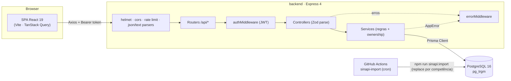
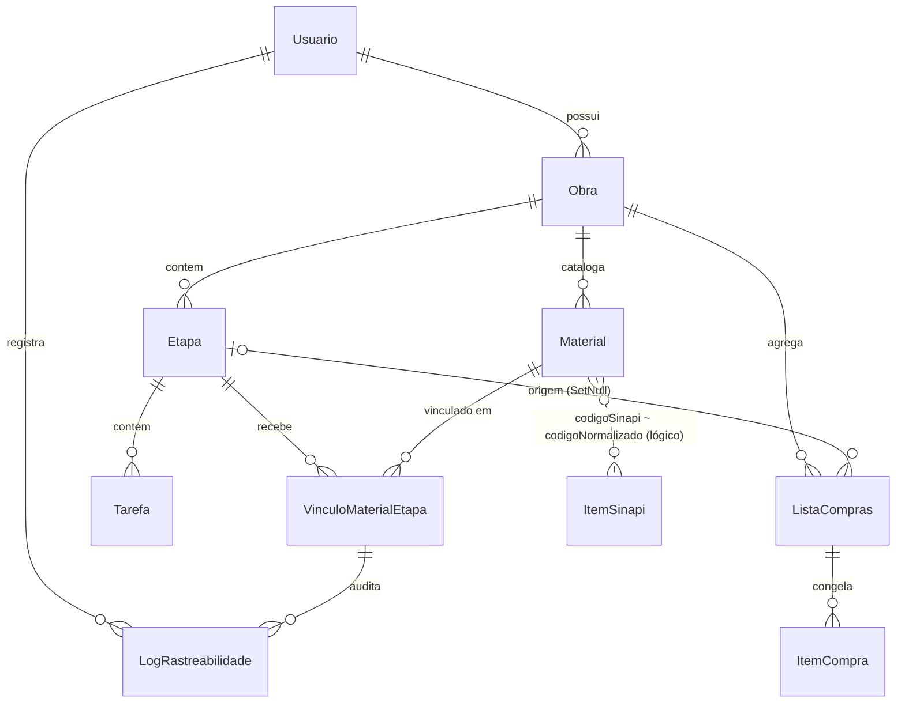
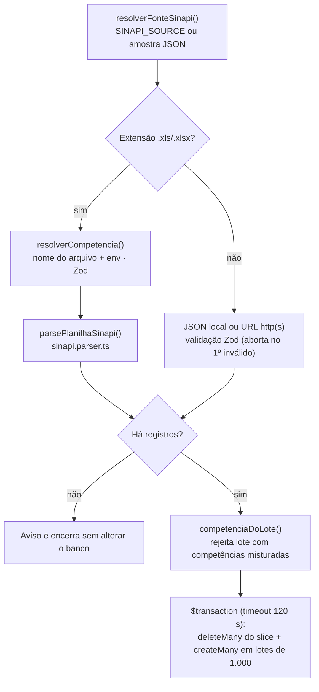
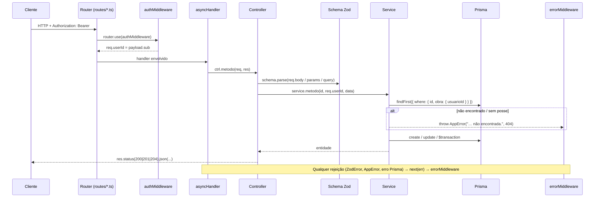
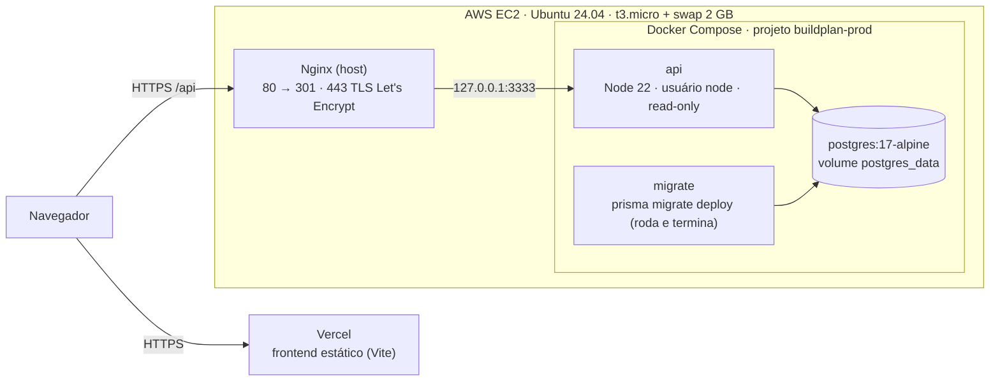
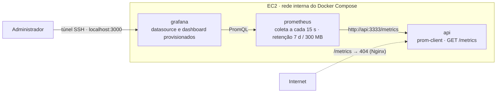

# Build-Plan — Raio-X Arquitetural e Técnico

> **Documento vivo** · Última revisão em 2026-11-17, com base no `main` (commit `b34ca14`, pós-merge do PR #29) **mais** a branch `fix-correcoes-pos-revisao` (saldo do material, etapa em execução no dashboard, lista de compras em preto e branco). Ver [Histórico de revisões](#histórico-de-revisões).
> Objetivo: consolidar decisões, padrões e convenções dos marcos M1–M7 + SINAPI (catálogo, importador, precificação automática) + Cronograma/Tarefas + exportações + segurança e produção, e servir de mapa para as próximas fases.
> Documentos relacionados: [RFC.md](RFC.md) · [aderencia-rfc.md](aderencia-rfc.md) · [marco-m4-consolidacao.md](marco-m4-consolidacao.md) · [marco-m5-consolidacao.md](marco-m5-consolidacao.md) · [frontend-consolidacao.md](frontend-consolidacao.md) · [registro-comparacao.md](registro-comparacao.md)

---

## Sumário executivo

| Dimensão | Resumo |
|---|---|
| **Arquitetura** | Monorepo com dois pacotes independentes (`backend/`, `frontend/`), cada um com `package.json` e lockfile próprios. Sem workspace raiz. |
| **Backend** | API REST em Express 4 + TypeScript (ESM/NodeNext), camadas *schema Zod → controller → service → Prisma*. Autenticação JWT HS256 stateless. |
| **Persistência** | PostgreSQL via Prisma 6 (16 em desenvolvimento e CI, 17 em produção). 11 models, 7 enums, 5 migrações. Busca textual SINAPI com `pg_trgm` + índice GIN; correspondência de código via `codigoNormalizado`. |
| **Frontend** | SPA React 19 + Vite 8, TanStack Query 5 para estado de servidor, Context API para sessão e obra ativa, shadcn/ui (Radix) + Tailwind 3. |
| **Testes** | Backend: Jest + Supertest contra **banco real** (sem mocks de Prisma) — 26 suítes / 264 casos. Frontend: Vitest + Testing Library em jsdom, com mocks da camada `api/` — 30 arquivos / 183 casos. ESLint do frontend zerado. |
| **CI/CD** | 2 workflows GitHub Actions: `ci.yml` (lint · typecheck · testes com cobertura no backend e no frontend + análise SonarCloud + **deploy**) e a importação mensal agendada do SINAPI. A cada push na `main`, depois do Quality Gate, o job `deploy` publica as imagens no GHCR e atualiza a EC2 por AWS SSM; o frontend é publicado pela Vercel. |
| **Produção** | No ar desde 2026-11-16. Frontend na Vercel (`https://build-plan-two.vercel.app`); API e PostgreSQL 17 em Docker Compose numa EC2 Ubuntu, atrás de Nginx com HTTPS (`https://buildplan-api.duckdns.org/api`). Ver §5.4. |
| **Segurança** | helmet (CSP, HSTS), CORS por allowlist, rate limit por IP, validação fail-fast do ambiente, contêiner sem root e sem portas públicas além de 80/443. Recuperação de senha com token de uso único (só o hash no banco). |
| **Observabilidade** | `prom-client` na API (`GET /metrics`: métricas do Node.js, `http_requests_total` e `http_request_duration_seconds`), Prometheus (coleta a cada 15 s) e Grafana com dashboard provisionado. Ver §5.5. |
| **Domínio** | Usuário → Obras → Etapas → Tarefas (cronograma e progresso físico); Materiais (catálogo por obra) vinculados a Etapas com máquina de estados auditada; Listas de Compras como snapshot, precificadas automaticamente pelo catálogo SINAPI. |



---

## 1. Stack Tecnológica e Dependências Principais

### 1.1 Ferramentas centrais

| Ferramenta | Backend | Frontend | Observações |
|---|---|---|---|
| **Node.js** | 22.x LTS (CI) | 22.x LTS (CI) | Não há `engines` nem `.nvmrc`; a versão é fixada apenas nos workflows (Node 20 saiu de suporte em 04/2026). O importador SINAPI depende do `fetch` global (Node ≥ 18). |
| **Módulos** | ESM (`"type": "module"`) | ESM | Backend usa `module/moduleResolution: NodeNext` → **imports internos com sufixo `.js`**. |
| **TypeScript** | `^5.6.0` | `~6.0.2` | Versões diferentes entre pacotes. Backend: `strict` + `noUnusedLocals/Parameters`, `noImplicitReturns`, alvo ES2022. Frontend: `moduleResolution: bundler`, `verbatimModuleSyntax`, `erasableSyntaxOnly`, alvo ES2023. |
| **Execução dev** | `tsx watch` (`^4.23`) | Vite `^8.3` (porta 5173) | Backend compila para `dist/` com `tsc` em produção. |
| **Bundler** | — (`tsc`) | Vite 8 + `@vitejs/plugin-react` 6 | `build.cssMinify: "esbuild"` (contorna falsos positivos do lightningcss). Alias `@` → `src/`. |
| **ORM** | Prisma `^6.0.0` (`prisma` + `@prisma/client`) | — | `prisma.config.ts` define schema e pasta de migrações; datasource lê `DATABASE_URL`. |
| **Test runner** | Jest `^30.4` + ts-jest `^29.4` (preset ESM) + Supertest `^7.2`; cobertura pelo istanbul embutido no Jest | Vitest `^5.0` + jsdom `^29`; cobertura com `@vitest/coverage-v8` | Backend roda Jest com `NODE_OPTIONS=--experimental-vm-modules`; `isolatedModules: true` no `tsconfig` (exigência do ts-jest com `NodeNext`, elimina o aviso TS151002). O type-check fica com o `tsc --noEmit` do CI. |
| **Lint** | ESLint 10 (flat config) + typescript-eslint, globals Node (`eslint.config.js`) | ESLint 10 (flat config) + typescript-eslint, react-hooks, react-refresh | **0 problemas** nos dois pacotes; ambos rodam no CI. `components/ui/**` (shadcn) desliga `react-refresh/only-export-components`, pois exporta `*Variants`. |
| **Banco local** | Docker Compose: `postgres:16-alpine` + `pgadmin4` | — | Variáveis `POSTGRES_*`/`PGADMIN_*` vêm de um `.env` na raiz (não versionado). |

### 1.2 Backend — bibliotecas de runtime

| Biblioteca | Versão | Papel |
|---|---|---|
| `express` | ^4.19 | Roteamento HTTP; routers aninhados com `mergeParams`. |
| `zod` | ^3.23 | Validação de body/params/query **e** das variáveis de ambiente (`config/env.ts`). |
| `jsonwebtoken` | ^9.0 | Emissão/verificação de JWT HS256. |
| `bcrypt` | ^5.1 | Hash de senha (custo **12**, exigência do RFC §6.1). |
| `helmet` | ^7.1 | Cabeçalhos de segurança HTTP (CSP `default-src 'none'`, HSTS de 1 ano, `no-referrer`). |
| `cors` | ^2.8 | CORS restrito à allowlist `CORS_ORIGINS` (métodos e headers explícitos). |
| `express-rate-limit` | ^8.7 | Limite de requisições por IP (`middlewares/rate-limit.middleware.ts`). |
| `prom-client` | ^15.1 | Métricas no formato do Prometheus (`lib/metricas.ts`). |
| `nodemailer` | ^10.6 | Envio de e-mail por SMTP (`services/email.service.ts`): link de redefinição de senha. |
| `exceljs` | ^4.4 | Geração do `.xlsx` da lista de compras (com `overrides` fixando `uuid` 11.1.1). |
| `pdfkit` | ^0.20 | Geração do `.pdf` da lista de compras. |
| `dotenv` / `dotenv-cli` | ^16.4 / ^7.4 | Carga de `.env` (app) e `.env.test` (scripts de teste). |
| `@prisma/client` | ^6.0 | Acesso a dados (singleton em `lib/prisma.ts`). |

**Tratamento assíncrono:** não há `express-async-errors`; usa-se o wrapper próprio `asyncHandler` (ver §3.4).
**Sem dependências para CSV:** o parsing do Memorial e a exportação de listas em CSV são implementados nativamente.
**Leitura de planilhas:** `xlsx` `^0.18.5` entra em `devDependencies`, pois só o importador SINAPI o usa (nenhuma rota da API o carrega). O `npm audit` aponta vulnerabilidades altas sem correção disponível no npm (ver §7, item 16).

### 1.3 Frontend — bibliotecas de runtime

| Categoria | Biblioteca | Versão | Uso |
|---|---|---|---|
| UI base | `react` / `react-dom` | ^19.2 | — |
| Roteamento | `react-router-dom` | ^7.18 | `BrowserRouter`, rotas aninhadas com `<Outlet />`. |
| Estado de servidor | `@tanstack/react-query` | ^5.104 | Queries/mutations e invalidação por chave. |
| HTTP | `axios` | ^1.20 | Cliente único com interceptors (`lib/api.ts`). |
| Formulários | `react-hook-form` + `@hookform/resolvers` + `zod` | ^7.90 / ^5.9 / ^3.25 | `zodResolver` em todos os dialogs e telas de auth. |
| Componentes | `radix-ui` (pacote unificado) + `shadcn` (CLI/registry, estilo `radix-nova`) | ^1.8 / ^4.22 | Componentes copiados em `components/ui/` (alert, badge, button, card, dialog, input, label, select, skeleton, table, tabs). |
| Estilo | `tailwindcss` 3.4 + `tw-animate-css` + `class-variance-authority` | — | Tema **dark** "Obsidian Precision" via variáveis HSL em `index.css`; `darkMode: ["class"]`. |
| Ícones / fontes | `lucide-react`, `@fontsource-variable/geist`, `@fontsource-variable/inter` | — | — |

> ⚠️ O pacote `cn` (`^0.5.0`) consta nas dependências, mas o helper `cn()` usado pelo shadcn vive em `src/lib/utils.ts`. Candidato a remoção.

---

## 2. Banco de Dados e Camada de Persistência

### 2.1 Configuração do PostgreSQL e schemas

| Ambiente | Banco / schema | Origem |
|---|---|---|
| Desenvolvimento | `buildplan_db`, `schema=public` | `backend/.env` (modelo em `.env.example`) |
| Testes locais | mesmo servidor, **`schema=test_buildplan`** | `backend/.env.test` (não versionado) |
| CI `ci.yml` (job `backend`) | `buildplan_test`, `schema=public` | variáveis do job |
| Produção | `buildplan`, `schema=public` (PostgreSQL 17, volume `buildplan-prod_postgres_data`) | `deploy/.env` na EC2, montado pelo `docker-compose.prod.yml` |
| Workflow `sinapi-import.yml` | `secrets.DATABASE_URL` | Não alcança o banco de produção atual, que não tem porta pública (§7, item 23) |

**Extensões:**

- `pg_trgm` — criada na migração `20261101024434_add_item_sinapi` com `CREATE EXTENSION IF NOT EXISTS pg_trgm WITH SCHEMA public`.
  **Decisão importante:** a extensão é forçada no schema `public` e o índice referencia explicitamente `public.gin_trgm_ops`, para que o mesmo banco sirva aos schemas `public` (dev) e `test_buildplan` (testes) sem conflito de instalação.
- Índice: `idx_item_sinapi_descricao_trgm ON "ItemSinapi" USING gin ("descricao" public.gin_trgm_ops)` — acelera o `ILIKE` gerado por `contains … mode: "insensitive"`.

### 2.2 Convenções do schema

- **PKs:** `String @id @default(uuid())` em todas as entidades.
- **Nomes físicos:** models em PascalCase, tabelas/colunas em `snake_case` via `@@map`/`@map` (ex.: `Obra` → `obra`, `usuarioId` → `usuario_id`).
  *Exceção:* `ItemSinapi` **não** usa `@@map`/`@map` (tabela `"ItemSinapi"`, colunas camelCase) — inconsistência a padronizar.
- **Auditoria temporal:** `createdAt @default(now())` + `updatedAt @updatedAt` (exceto `ListaCompras`, `ItemCompra` e `LogRastreabilidade`, que são registros imutáveis/snapshot).
- **Quantidades:** `Decimal(12,3)`; **valores monetários:** `Decimal(12,2)`. Serializados como string no JSON.
- **Índices:** toda FK tem `@@index`; colunas de filtro frequente (`status`, `codigoSinapi`, `codigo`, `uf`) também.
- **Exclusão:** cascata a partir de `Usuario`/`Obra`; `ListaCompras.etapa` usa `SetNull` (preserva histórico de compras se a etapa for removida).

### 2.3 Enums

| Enum | Valores | Uso |
|---|---|---|
| `PapelUsuario` | `GESTOR` (default), `PROPRIETARIO` | Papel do usuário (ainda sem autorização por papel). |
| `OrigemMaterial` | `MEMORIAL`, `MANUAL` (default) | Procedência do insumo (UC01 vs. cadastro manual). |
| `StatusVinculo` | `PREVISTO` → `RECEBIDO` → `APLICADO` | Máquina de estados RN01 do vínculo material-etapa. |
| `StatusTarefa` | `PENDENTE`, `EM_ANDAMENTO`, `CONCLUIDA`, `BLOQUEADA` | Estado de tarefas (M3). |
| `OrigemPreco` | `SINAPI`, `MANUAL`, `PENDENTE` | Procedência do preço congelado em `ItemCompra` (PR #21). |
| `RegimeSinapi` | `DESONERADO`, `NAO_DESONERADO` (default) | Regime de desoneração da tabela SINAPI. |
| `TipoSinapi` | `INSUMO` (default), `COMPOSICAO` | Natureza do item SINAPI. |

### 2.4 Mapa de models

| Model (tabela) | Campos-chave | Únicos / índices | Relações |
|---|---|---|---|
| **Usuario** (`usuario`) | `nome`, `email`, `senhaHash`, `papel`, `consentimentoEm?` (aceite da Política de Privacidade) | `email @unique` | 1:N `Obra` · 1:N `LogRastreabilidade` · 1:N `TokenRedefinicaoSenha` |
| **TokenRedefinicaoSenha** (`token_redefinicao_senha`) | `usuarioId`, `tokenHash` (SHA-256 do token), `expiraEm` | `tokenHash @unique` · idx `usuarioId` | N:1 `Usuario` (Cascade). O token real nunca é gravado. |
| **Obra** (`obra`) | `nome`, `descricao?`, `endereco?`, `usuarioId` | idx `usuarioId` | N:1 `Usuario` (Cascade) · 1:N `Etapa`, `Material`, `ListaCompras` |
| **Etapa** (`etapa`) | `nome`, `descricao?`, `ordem` (default 0), `dataInicio?`, `dataFim?`, `obraId` | idx `obraId` | N:1 `Obra` (Cascade) · 1:N `Tarefa`, `VinculoMaterialEtapa`, `ListaCompras` |
| **Tarefa** (`tarefa`) | `titulo`, `status`, `dataInicioPrev?`, `dataFimPrev?`, `dataConclusao?`, `ordem`, `etapaId` | idx `etapaId`, `status` | N:1 `Etapa` (Cascade) |
| **Material** (`material`) | `nome`, `especificacao?`, `unidade`, `quantidade` Dec(12,3), `origem`, `codigoSinapi?`, `obraId` | idx `obraId`, `codigoSinapi` | N:1 `Obra` (Cascade) · 1:N `VinculoMaterialEtapa`. **Pertence à obra, não à etapa** (RFC §5.2). |
| **VinculoMaterialEtapa** (`vinculo_material_etapa`) | `quantidade`, `status`, `local?`, `dataRecebimento?`, `dataAplicacao?` | **`@@unique([materialId, etapaId])`** · idx `etapaId`, `status` | N:1 `Material` e `Etapa` (Cascade) · 1:N `LogRastreabilidade` |
| **ListaCompras** (`lista_compras`) | `obraId`, `etapaId?`, `geradaEm` | idx `obraId`, `etapaId` | N:1 `Obra` (Cascade) · N:1 `Etapa` (**SetNull**) · 1:N `ItemCompra` |
| **ItemCompra** (`item_compra`) | `materialId?` (sem FK), `descricao`, `unidade`, `quantidade`, `precoUnitario?` Dec(12,2), `precoTotal?`, `origemPreco?` (enum `OrigemPreco`) | idx `listaComprasId` | N:1 `ListaCompras` (Cascade). Snapshot desnormalizado do material. |
| **LogRastreabilidade** (`log_rastreabilidade`) | `statusAnterior?`, `statusNovo`, `detalhes?`, `criadoEm` | idx `vinculoId`, `usuarioId` | N:1 `VinculoMaterialEtapa` (Cascade) · N:1 `Usuario` (**Restrict**) |
| **ItemSinapi** (`"ItemSinapi"`) | `codigo`, `codigoNormalizado`, `descricao`, `unidade`, `precoMediano` Dec(12,2), `uf` Char(2), `mesReferencia`, `anoReferencia`, `regime`, `tipo` | **`@@unique([codigo, uf, mesReferencia, anoReferencia, regime])`** (chave natural do importador) · idx `codigo`, `uf`, `(codigoNormalizado, uf, mesReferencia, anoReferencia)` · GIN trgm `descricao` | **Nenhuma FK.** Ligação lógica com `Material.codigoSinapi` via `normalizarCodigoSinapi()` (trim + zeros à esquerda). |



**Regras de domínio materializadas no modelo:**

- **RN01** — `StatusVinculo` só avança um passo (`PREVISTO → RECEBIDO → APLICADO`); sem pular nem retroceder.
- **Saldo do material** — a soma das quantidades vinculadas de um material (todas as etapas) não passa de `Material.quantidade`; a quantidade do material também não pode ser reduzida abaixo do já vinculado (`services/material-saldo.ts`).
- **RNF04** — toda transição gera um `LogRastreabilidade` imutável na mesma `$transaction`.
- **Snapshot de compras** — `ItemCompra` copia descrição/unidade/quantidade/preço no momento da geração; não é recalculado.
- **`origemPreco`** — enum `OrigemPreco` (`SINAPI` na geração com preço encontrado, `PENDENTE` sem correspondência, `MANUAL` após "Informar preço").
- **Tarefas** — `dataConclusao` existe **somente** em tarefa `CONCLUIDA`: preenchida ao concluir (sem sobrescrever uma data já existente) e limpa (`null`) ao reabrir (ver §3.5).

### 2.5 Migrações e seeds

| Migração | Conteúdo |
|---|---|
| `20260713005855_init` | Usuario, Obra, Etapa, Material, VinculoMaterialEtapa, ListaCompras, ItemCompra, LogRastreabilidade + enums iniciais e índices. |
| `20260915014726_m3_etapas_tarefas` | Enum `StatusTarefa`, tabela `tarefa`, `etapa.ordem` passa a `NOT NULL DEFAULT 0`. |
| `20261101024434_add_item_sinapi` | Enums `RegimeSinapi`/`TipoSinapi`, tabela `ItemSinapi`, extensão `pg_trgm` e índice GIN (SQL manual anexado à migração gerada). |
| `20261116120000_recuperacao_senha_consentimento` | Tabela `token_redefinicao_senha` e coluna `usuario.consentimento_em` (anulável: contas anteriores não têm o registro). |
| `20261102120000_origem_preco_enum_codigo_normalizado` | Enum `OrigemPreco` (conversão de `item_compra.origem_preco` com `USING UPPER(...)::"OrigemPreco"`, preservando dados); coluna `ItemSinapi.codigoNormalizado` com backfill SQL equivalente a `normalizarCodigoSinapi()` e índice composto de resolução de preço. |

**Fluxo de migrações**

- Dev: `npm run prisma:migrate` (`prisma migrate dev`).
- Testes locais: `pretest` → `test:migrate` (`dotenv -e .env.test -- prisma migrate deploy`) — o schema de teste é migrado automaticamente antes de cada `npm test`.
- CI: `npx prisma generate` + `npx prisma migrate deploy`.
- SQL específico de PostgreSQL (extensões, índices GIN, opclasses) é **acrescentado manualmente** ao `migration.sql` gerado, pois o Prisma não o expressa no schema.

**Seeds**

- Não há `prisma db seed` configurado.
- Os dados semente são carregados por `npm run sinapi:import` (`src/scripts/importSinapi.ts`), a partir de `SINAPI_SOURCE`; ausente, vazia ou só com espaços, usa a amostra JSON (`resolverFonteSinapi`, com `||` + `trim`).

| Fonte | Arquivo | Conteúdo |
|---|---|---|
| Amostra JSON (default) | `prisma/seed/sinapi.sample.json` | 10 registros, SC, ref. 08/2025, `NAO_DESONERADO`. |
| Planilha oficial | `prisma/seed/sinapi/SINAPI 202609 SC.xlsx` (~1 MB) | Relatório da Caixa, ref. 09/2026, aba `ISD (2)` (sem desoneração): 4.878 insumos, 4.135 com preço válido em SC. Também é a fixture de `sinapi.parser.spec.ts`. |

**Fluxo do importador**



- **Estratégia replace-by-competência:** apaga o slice `uf + mesReferencia + anoReferencia + regime` e reinsere tudo na mesma transação. Reexecutar é **idempotente** quanto ao conteúdo, mas os `id` dos itens mudam a cada carga; hoje isso não tem impacto, pois `ItemSinapi` não é alvo de FK.
- **Regras puras em `modules/sinapi/sinapi.import.ts`** (testadas em `sinapi.import.spec.ts`, sem banco): `resolverFonteSinapi`, `resolverCompetencia`, `registroSinapiSchema` e `competenciaDoLote`. O script só orquestra I/O.
- **Competência da planilha:** derivada do nome do arquivo (`…YYYYMM… UF.xlsx`), com override por `SINAPI_UF`, `SINAPI_MES`, `SINAPI_ANO` e `SINAPI_REGIME` (envs vazias são ignoradas). Validada via **Zod**: mês 1–12, ano 2000–2100, UF com 2 letras e regime do enum (sem cast). Sem ano/mês definidos, o importador aborta. Os defaults são UF `SC` e regime `NAO_DESONERADO`.
- **Parser:** localiza as colunas pelo texto normalizado do cabeçalho (linha 10), o que tolera mudanças de posição entre competências. Ignora linhas sem código, descrição, unidade ou preço positivo na UF, e grava `tipo = INSUMO`: composições ainda não são importadas.
- **Limitações:**
  - planilhas só são lidas de caminho local; URL funciona apenas para JSON;
  - um JSON com mais de uma competência é **rejeitado** antes da transação (`competenciaDoLote`) — importe uma competência por vez;
  - a aba é fixa em `ISD (2)` (sem desoneração) e `SINAPI_REGIME` não é conferido contra ela (ver §7, item 18).

---

## 3. Arquitetura do Backend

### 3.1 Estrutura de diretórios

```text
backend/
├── prisma/
│   ├── schema.prisma
│   ├── migrations/            # 5 migrações + migration_lock.toml
│   └── seed/
│       ├── sinapi.sample.json
│       └── sinapi/SINAPI 202609 SC.xlsx   # planilha oficial e fixture do parser
├── prisma.config.ts
├── jest.config.ts
├── Dockerfile                 # imagem de produção multi-stage (build/ferramentas + runtime sem root)
└── src/
    ├── server.ts              # app.listen(env.PORT) + encerramento gracioso (SIGTERM/SIGINT)
    ├── app.ts                 # createApp(opcoes): métricas, helmet, CORS, rate limit, rotas, errorMiddleware (importável pelo Supertest)
    ├── config/env.ts          # validação Zod das variáveis (fail-fast, com regras extras em produção)
    ├── config/sinapi.config.ts # competência/UF/regime de referência da precificação (Zod + defaults)
    ├── errors/app-error.ts    # AppError(message, statusCode)
    ├── lib/prisma.ts          # PrismaClient singleton (globalThis)
    ├── lib/metricas.ts        # prom-client: registro, middleware HTTP e router de GET /metrics
    ├── middlewares/           # async-handler, auth.middleware, error.middleware, rate-limit.middleware
    ├── types/express.d.ts     # augmenta Request com userId: string
    ├── schemas/               # Zod por recurso (*.schema.ts)
    ├── controllers/           # classes + instância singleton exportada
    ├── services/              # classes + instância singleton exportada
    │   └── export/            # geradores puros da lista de compras: dados (modelo), xlsx, pdf, marca (cores/logo)
    ├── routes/                # routers Express por recurso
    ├── modules/sinapi/        # padrão modular: schema/controller/service/routes + codigo (normalização), parser (xlsx), import (regras do importador) e specs colocados
    ├── scripts/importSinapi.ts
    └── tests/                 # *.spec.ts + helpers/ + setup.ts
```

**Dois estilos coexistem:**

| Estilo | Onde | Características |
|---|---|---|
| **Camadas horizontais** (M1–M5) | `schemas/`, `controllers/`, `services/`, `routes/` | Classes (`ObraController`, `ObraService`) com singleton exportado (`obraController`). Rotas chamam `asyncHandler((req, res) => ctrl.metodo(req, res))`. |
| **Módulo vertical** (SINAPI) | `modules/sinapi/` | Funções exportadas (`getSinapi`, `buscarSinapi`), arquivos colocados por feature, teste ao lado do código. |

> Recomendação: decidir qual estilo é o padrão para os próximos marcos e registrar em ADR. O modular escala melhor; migrar os recursos legados é opcional.

### 3.2 Fluxo padrão de uma requisição



**Responsabilidades por camada**

| Camada | Faz | Não faz |
|---|---|---|
| `schemas/*.schema.ts` | Define `create*Schema`, `update*Schema` (`.partial().refine(≥1 campo)`), `*IdParamSchema` (UUID) e exporta tipos `z.infer`. Mensagens em português. | — |
| `controllers/*` | `parse` de params/body/query, chama o service passando `req.userId`, define status HTTP (`201` criar, `204` remover). | Regra de negócio, acesso ao Prisma. |
| `services/*` | Regras de negócio, **verificação de posse**, transações, cálculos (totais, progresso, percentuais). Lança `AppError`. | Conhecer `req`/`res`. |
| `routes/*` | Monta paths, aplica `authMiddleware` e `asyncHandler`, aninha sub-routers. | Lógica. |

**Padrões recorrentes nos services**

- **Ownership por cadeia relacional:** `where: { id, obra: { usuarioId } }` (ou `etapa: { obra: { usuarioId } }`). Recurso de outro usuário responde **404** (não 403), evitando enumeração.
- **Helpers privados** `assertObraDoUsuario` / `buscar<Entidade>DoUsuario` antes de `update`/`delete`.
- **Duplicidade:** checagem explícita + captura de `P2002` como rede de segurança contra corrida → `409`.
- **Atomicidade:** `prisma.$transaction(async (tx) => …)` para status + log e para lista + itens.
- **Decimal:** aritmética com `Prisma.Decimal` (`mul`, `add`, `toFixed(2)`), nunca `number`.

**Routers aninhados (`mergeParams: true`)**

Cada recurso exporta tipicamente dois routers: um **aninhado** (ex.: `obraMaterialRoutes` em `/api/obras/:obraId/materiais`, herda o `authMiddleware` do pai) e um de **recurso individual** (ex.: `materialRoutes` em `/api/materiais/:id`, aplica o próprio `authMiddleware`). Em `obra.routes.ts`, `obraMemorialRoutes` é montado **antes** de `obraMaterialRoutes` no mesmo prefixo para que `/preview-memorial` e `/importar-memorial` não colidam com rotas de material.

### 3.3 Autenticação e segurança

| Aspecto | Implementação |
|---|---|
| Registro | `POST /api/auth/register` → valida (`senha` 8–72 chars, limite do bcrypt; e-mail `toLowerCase`), `409` se e-mail existe, `bcrypt.hash(senha, 12)`, retorna `{ usuario, token }` com **201**. |
| Login | `POST /api/auth/login` → mensagem genérica `"Credenciais inválidas."` (401) para e-mail inexistente ou senha errada. |
| Token | `jwt.sign({}, JWT_SECRET, { subject: usuarioId, expiresIn: JWT_EXPIRES_IN, algorithm: "HS256" })`. **Único claim de domínio: `sub`** (+ `iat`/`exp`). Papel não vai no token. |
| `authMiddleware` | Exige `Authorization: Bearer <token>`; `jwt.verify` restrito a `["HS256"]`; payload string ou sem `sub` → 401; expirado/malformado → `"Token inválido ou expirado."` (401). Injeta **`req.userId = payload.sub`** (tipado em `types/express.d.ts`). |
| Aplicação | Por router (`router.use(authMiddleware)`), não global. Públicas: `GET /`, `GET /api/health`, `POST /api/auth/register`, `POST /api/auth/login`, `POST /api/auth/esqueci-senha`, `POST /api/auth/redefinir-senha`. `GET /metrics` não exige token, mas só atende a rede interna (§5.5). |
| Recuperação de senha | `recuperacao-senha.service.ts`. O pedido responde sempre igual, exista o e-mail ou não. Token de 32 bytes aleatórios, válido por 30 min e de uso único; o banco guarda só o SHA-256. Um novo pedido invalida os anteriores. O e-mail é enviado sem `await`, para o tempo de resposta não revelar se a conta existe. |
| Conta (LGPD) | `conta.service.ts`. `PUT /api/auth/me` corrige nome e e-mail (409 se o e-mail é de outra conta). `DELETE /api/auth/me` exige a senha (400 se errada) e apaga, numa transação, obras (cascata), logs e o usuário. O cadastro exige `aceitePrivacidade: true` e grava `consentimentoEm`. |
| Respostas | Hash de senha nunca sai (selects explícitos). Erros 500 respondem genérico. |
| Env | `config/env.ts` valida tudo na inicialização e encerra (`process.exit(1)`) se algo for inválido, logando só o nome do campo e a mensagem (nunca o valor). `JWT_SECRET` ≥ 16 caracteres. **Em produção:** `JWT_SECRET` ≥ 32 e sem trechos de exemplo (`troque`, `changeme`, `example`…), `DATABASE_URL` sem senha de desenvolvimento, `CORS_ORIGINS` obrigatória, com `https://` e sem `localhost`. |
| Cabeçalhos | `helmet`: CSP `default-src 'none'` (a API só devolve JSON e arquivos), HSTS de 1 ano, `Cross-Origin-Resource-Policy: cross-origin`, `Referrer-Policy: no-referrer`; `X-Powered-By` removido. |
| CORS | Allowlist `CORS_ORIGINS` (nunca `*`), métodos e headers explícitos, `exposedHeaders: Content-Disposition, Retry-After`. Cada origem deve ser exatamente o que o navegador envia: esquema + host em minúsculas, sem barra final. |
| Rate limit | `express-rate-limit`, contadores em memória, por IP: **API** 300 req/min (ignora `/health`); **login** 10 falhas/15 min (logins bem-sucedidos não contam); **cadastro** 10/h; **recuperação de senha** 5/h (pedido e redefinição). Resposta `429 { message }` com headers `RateLimit` (draft-7) e `Retry-After`. Desligado quando `NODE_ENV=test`; os testes o ligam por `createApp({ rateLimit: true, limites })`. |
| IP do cliente | `app.set("trust proxy", TRUST_PROXY)`: `1` em produção (o Nginx), `0` fora. Sem isso, o rate limit veria todos os clientes com o IP do proxy; com um valor alto demais, o `X-Forwarded-For` seria forjável. |
| Limites de payload | `express.json({ limit: "1mb" })`; `express.text` para `text/csv`/`text/plain` até 2 MB (UC01). |

**Lacunas conhecidas:** rate limit em memória (vale para uma única instância e zera ao reiniciar), sem refresh token, trocar a senha não invalida os JWT já emitidos (stateless, expiram em 8 h), sem autorização por `papel`, token em `localStorage` no front (trade-off documentado em `lib/token.ts`).

### 3.4 Tratamento de erros e utilitários

| Utilitário | Arquivo | Comportamento |
|---|---|---|
| `AppError` | `errors/app-error.ts` | `new AppError(mensagem, statusCode = 400)`; `Object.setPrototypeOf` garante `instanceof` correto. |
| `asyncHandler` | `middlewares/async-handler.ts` | `Promise.resolve(fn(req,res,next)).catch(next)` — elimina `try/catch` nos controllers. Antes de chamar o handler, registra o padrão da rota para as métricas (`marcarRota`). |
| `errorMiddleware` | `middlewares/error.middleware.ts` | Registrado **por último** em `app.ts`. |

Contrato de resposta de erro:

```jsonc
// ZodError → 400
{ "message": "Erro de validação.", "issues": [{ "campo": "nome", "mensagem": "O nome deve ter ao menos 3 caracteres." }] }

// AppError → statusCode do erro
{ "message": "Obra não encontrada." }

// Qualquer outro → 500 (com console.error("[erro-nao-tratado]", err))
{ "message": "Erro interno do servidor." }
```

> Observação: `authMiddleware` lança `AppError` de forma síncrona; funciona porque o Express 4 captura exceções síncronas de middlewares e repassa ao handler de erro.

### 3.5 Funcionalidades notáveis por serviço

| Serviço | Destaques |
|---|---|
| `etapa.service` | Listagem retorna `totalTarefas`, `tarefasConcluidas`, `progresso` (0–100) e `totalMateriaisVinculados`, usado pelo aviso da RN02 ao excluir a etapa. |
| `email.service` | Envio por SMTP (nodemailer). Sem `SMTP_HOST` nada é enviado: em desenvolvimento a mensagem vai para o console; em produção só se registra que não houve envio, sem o conteúdo (ele carrega o link secreto). |
| `tarefa.service` | `resolverDataConclusao()` centraliza a regra: concluir sem data → `new Date()` (inclusive ao **criar** já `CONCLUIDA`); reenviar `CONCLUIDA` **não** sobrescreve a data existente; sair de `CONCLUIDA` → `null`. No `PUT`, `descricao`, `dataInicioPrev`, `dataFimPrev` e `dataConclusao` aceitam `null` (limpa o campo); ausente mantém o valor. |
| `vinculo-material.service` | Máquina RN01 (`TRANSICOES_VALIDAS`), preenche `dataRecebimento`/`dataAplicacao` sem sobrescrever, log na mesma transação; valida material e etapa da **mesma obra** (400). Ao criar, confere o **saldo** do material numa transação com a linha do material travada (`SELECT … FOR UPDATE`, `travarMaterial`): dois vínculos simultâneos não passam juntos da quantidade do catálogo (400 com saldo, total e já vinculado na mensagem). |
| `lista-compras.service` | Gera snapshot a partir dos vínculos da etapa (400 se vazia); totais `{ totalItens, itensSemPreco, totalOrcado }`. **Precificação automática** (PR #21): `resolverPrecosReferencia()` faz **uma única** consulta `itemSinapi.findMany({ codigoNormalizado: { in: [...] }, uf, mês, ano, regime })` na competência de `sinapiConfig` e casa os vínculos por `Map` em memória (sem N+1). |
| `item-compra.service` | "Informar preço": recalcula `precoTotal` e marca `origemPreco = "MANUAL"`. |
| `material.service` | CRUD do catálogo; no `PUT`, `especificacao: null` limpa o campo. Reduzir `quantidade` abaixo do total já vinculado responde 400 (mesma trava do vínculo). |
| `memorial.service` | Parser CSV nativo: detecta delimitador (`;`, `,`, tab) pelo cabeçalho, respeita aspas, normaliza cabeçalhos; `preview` não persiste e devolve linhas válidas/rejeitadas; `importar` cria materiais com `origem: MEMORIAL`. |
| `export.service` | Três formatos, todos com `Content-Disposition: attachment`. **CSV** RFC 4180 (CRLF, escape de aspas). **XLSX** e **PDF** (PR #26) partem do mesmo modelo (`services/export/lista-compras.dados.ts`) e de geradores puros, testados sem banco: a planilha tem bloco de cabeçalho, tabela estilizada, subtotal por fórmula (`=IF(ISNUMBER(E),D*E,"")`), total com `=SUM` e destaque para itens `PENDENTE`; o PDF usa as mesmas cores e logo (`marca.ts`). Os geradores recebem uma **paleta** (`PaletaExportacao`, com papéis como `destaque`, `texto` e `alertaClaro`): a colorida é o padrão e `?tema=pb` usa a preto e branco (só cinzas, texto preto, bordas mais escuras, pendentes em cinza), pedida por usuários cujas impressoras deixavam a versão colorida apagada. Nome do arquivo: `lista-compras-<etapa>.<ext>` (`slugificar`), com sufixo `-pb` na versão preto e branco. |
| `dashboard.service` | KPIs: totais de etapas/materiais, vínculos por status com percentual, progresso de tarefas, orçamento consolidado. |
| `log.service` | Timeline por vínculo e agregado por obra. |
| `modules/sinapi` | Busca `descricao ILIKE %q%` **ou** `codigo LIKE q%` **ou** `codigoNormalizado LIKE normalizar(q)%` ("370" encontra "00000370"), filtros `uf`/`regime`, `limit` 1–50 (default 10), ordenada por `codigo` e `descricao`. **Não filtra por competência** (ver §7, item 15). `sinapi.parser.ts` lê a planilha oficial e é usado apenas pelo importador. |

---

## 4. Arquitetura do Frontend

### 4.1 Estrutura de diretórios

```text
frontend/src/
├── main.tsx             # QueryClientProvider > BrowserRouter > AuthProvider > ObraProvider > App
├── App.tsx              # rotas públicas + privadas (ProtectedRoute > AppLayout)
├── index.css            # tokens HSL do tema dark (shadcn)
├── api/                 # funções HTTP por domínio (authApi, obrasApi, comprasApi, sinapiApi…)
├── auth/                # AuthContext (provider), AuthContextDef (objeto + tipo), useAuth, ProtectedRoute (+ testes)
├── contexts/            # ObraContext (provider), ObraContextDef (objeto + tipo), useObraAtiva (+ teste)
├── hooks/               # hooks TanStack Query por domínio + useDebounce
├── components/
│   ├── ui/              # primitivos shadcn/Radix
│   ├── layout/          # AppLayout, Sidebar
│   └── <domínio>/       # compras, cronograma, dashboard, materiais, memorial, obras, rastreabilidade
├── pages/<domínio>/     # uma página por tela (Tela 1–6 + Cronograma) + auth
├── lib/                 # api (Axios), queryClient, token, format, download, utils (cn) + regras puras testadas:
│                        #   tarefas (progresso físico, payloads), suprimentos (progresso por etapa),
│                        #   sinapi (referência UF/regime), memorialTemplate (CSV modelo)
├── types/               # contratos TS espelhando as respostas da API
└── test/                # setup.ts (polyfills Radix) e utils.tsx (renderComProviders)
```

**Camadas do front:** `pages` → `components` → `hooks` (React Query) → `api` (Axios) → `lib/api.ts`. Componentes nunca chamam Axios diretamente.

### 4.2 Rotas e telas

| Rota | Página | Tela / marco |
|---|---|---|
| `/login`, `/register` | `LoginPage`, `RegisterPage` | Públicas. O cadastro exige o aceite da Política de Privacidade |
| `/esqueci-senha`, `/redefinir-senha` | `EsqueciSenhaPage`, `RedefinirSenhaPage` | Públicas. Pedido do link e definição da nova senha (token na query) |
| `/privacidade` | `PrivacidadePage` | Pública. Política de Privacidade (RFC §6.2) |
| `/conta` | `ContaPage` | Privada. Editar nome e e-mail; excluir a conta com confirmação por senha |
| `/obras` | `ObrasPage` | Tela 1 — home pós-login, seleção da obra ativa |
| `/dashboard` | `DashboardPage` | KPIs da obra (M5), progresso físico e suprimentos por etapa. O card "Materiais por etapa" abre na **etapa em execução** (a primeira, pela ordem, com material ainda não aplicado; `encontrarEtapaEmExecucao` em `lib/suprimentos.ts`) e permite escolher outra etapa |
| `/cronograma` | `CronogramaPage` | Tarefas por etapa, troca rápida de status (otimista) e progresso físico (PR #22). Exclusão de etapa com aviso de materiais vinculados (RN02, `ExcluirEtapaDialog`) |
| `/memorial` | `MemorialPage` | UC01 — dropzone, stepper, revisão e importação |
| `/materiais` | `MateriaisPage` | Catálogo, etapas e vínculos. O painel do material e o diálogo de vínculo mostram o saldo (`calcularSaldoMaterial`); o diálogo não envia quantidade acima dele |
| `/compras` | `ComprasPage` | Listas de compras, "Informar preço" com sugestão SINAPI, exportação em Excel, PDF e CSV (`ExportacaoCard`), com opção de versão preto e branco para Excel e PDF |
| `/rastreabilidade` | `RastreabilidadePage` | Mudança de status e timeline (Tela 6) |
| `/`, `*` | — | Redirecionam para `/obras` |

### 4.3 Estado global e contextos

| Contexto | Estado | Persistência | Observações |
|---|---|---|---|
| **AuthContext** (`auth/AuthContext.tsx`) | `usuario`, `loading`, `autenticado`, `login()`, `logout()`, `setUsuario()` | Token em `localStorage["buildplan.token"]` via `tokenStorage` | `loading` inicia `true` só se houver token (inicialização lazy); na montagem restaura a sessão com `GET /auth/me`; falha → limpa token. Consumido via `useAuth()`. |
| **ObraContext** (`contexts/ObraContext.tsx`) | `obraAtivaId`, `selecionarObra()`, `limparObraAtiva()` | `localStorage["buildplan.obraAtiva"]` | Lida no primeiro render via `useState(() => …)` (sem effect + setState). Fornece o `obraId` às Telas 2–6. Consumido via `useObraAtiva()`. |
| **TanStack Query** | Todo estado de servidor | Memória | Defaults: `retry: 1`, `refetchOnWindowFocus: false`, `staleTime: 30s`. |

`ProtectedRoute` exibe "Carregando sessão…" enquanto `loading`, redireciona para `/login` sem sessão e renderiza `<Outlet />` caso contrário.

> Os objetos de contexto ficam em `*ContextDef.ts`, separados dos providers, para que os `.tsx` exportem só componentes (Fast Refresh).
>
> **Padrão dos dialogs:** o formulário (react-hook-form) é sincronizado com `reset()` num `useEffect` ao abrir; o estado local (`erro`, busca, seleção) é limpo **ao fechar**, em `handleOpenChange(false)`, e não com `setState` dentro do effect (regra `react-hooks/set-state-in-effect`).

### 4.4 Integração com a API

**Cliente Axios (`lib/api.ts`)**

- `baseURL = resolverApiBaseUrl(import.meta.env)` (`lib/apiBaseUrl.ts`): usa `VITE_API_URL` sem barras finais; ausente ou vazia, cai em `http://localhost:3333/api`. A variável é embutida no build. Na Vercel, o `vite.config.ts` **falha o build** se ela faltar ou não for `https://` (`exigirApiUrlNaVercel`), para nunca publicar um site apontando para `localhost`.
- Downloads binários (`.xlsx`/`.pdf`) usam `responseType: "blob"` e `baixarBlob()` (`lib/download.ts`).
- Interceptor de **request**: injeta `Authorization: Bearer <token>` quando existe.
- Interceptor de **response**: em `401` fora de `/auth/login` e `/auth/register` → `tokenStorage.clear()` + `window.location.assign("/login")`.

**Padrão de módulo `api/`** — objeto literal por domínio, uma função por endpoint, tipada com `types/`, comentário com o verbo+rota:

```ts
// GET /api/obras/:obraId/listas-compras
async listarPorObra(obraId: string): Promise<ListaCompras[]> {
  const { data } = await api.get<ListaCompras[]>(`/obras/${obraId}/listas-compras`);
  return data;
}
```

**Chaves de query e invalidação**

| Query key | Hook(s) | Invalidada por |
|---|---|---|
| `["obras"]` (`OBRAS_QUERY_KEY`) | `useObras` | criar/editar/excluir obra · importar memorial |
| `["dashboard", obraId]` | `useDashboard` | **praticamente toda mutação** (materiais, etapas, vínculos, status, listas, itens, memorial) |
| `["materiais", obraId]` | `useMateriais` | criar/editar/excluir material |
| `["etapas", obraId]` | `useEtapas` | criar etapa · criar/remover vínculo |
| `["vinculos", etapaId]` | `useVinculosPorEtapa`, `useVinculosDaObra` (`useQueries` por etapa; `isLoading` inclui o carregamento das etapas) | criar/remover vínculo · mudar status |
| `["tarefas", etapaId]` | `useTarefas` | criar/editar/excluir/alterar status de tarefa (cascata: também `["etapas", obraId]` e `["dashboard", obraId]`; status com update otimista) |
| `["logs", vinculoId]` | `useLogsVinculo` | `useAtualizarStatusVinculo` |
| `["listas-compras", obraId]` | `useListasCompras` | gerar/excluir lista · atualizar/excluir item |
| `["sinapi", params]` | `useBuscaSinapi` | — (`staleTime` 5 min, `keepPreviousData`, habilitada só com `q.length ≥ 2`) |

Convenções: queries dependentes de obra usam `enabled: !!obraId`; mutações invalidam no `onSuccess` (sem updates otimistas); o dashboard é tratado como **agregado derivado** e sempre invalidado.

**Formulários:** `react-hook-form` + `zodResolver` em `LoginPage`, `RegisterPage` e nos dialogs (`ObraFormDialog`, `MaterialFormDialog`, `EtapaFormDialog`, `VincularEtapaDialog`, `MudarStatusDialog`, `InformarPrecoDialog`, `TarefaFormDialog`). Na **edição**, campos opcionais apagados são enviados como `null` (`montarPayloadEdicaoTarefa`, especificação do material); na criação são omitidos. Os schemas Zod do front são **duplicados** dos do back (não há pacote compartilhado).

**Busca SINAPI no `InformarPrecoDialog`:** chama `useBuscaSinapi({ q, uf, regime, limit: 8 })` com a referência de `lib/sinapi.ts` (`VITE_SINAPI_UF`/`VITE_SINAPI_REGIME`, defaults `SC`/`NAO_DESONERADO` — os mesmos de `sinapi.config.ts` no backend), para que a sugestão bata com a precificação automática. As sugestões aparecem em lista flutuante (`absolute`, `z-50`), que sobrepõe o modal sem deslocar os campos abaixo.

---

## 5. Estratégia de Testes e CI/CD

### 5.1 Backend

| Item | Configuração |
|---|---|
| Runner | Jest 30 + ts-jest (preset `default-esm`), `testEnvironment: node`, `moduleNameMapper` remove o sufixo `.js` dos imports. |
| Descoberta | `roots: ["<rootDir>/src"]`, **`testMatch: ["**/*.spec.ts"]`**. |
| Estilo | **Integração ponta a ponta**: Supertest importa `app` de `app.ts` (sem `listen`) e exercita rotas reais contra **PostgreSQL real**. Não há mocks de Prisma. |
| Isolamento | `.env.test` aponta para o schema `test_buildplan`; `setup.ts` executa `resetDatabase()` (**TRUNCATE … RESTART IDENTITY CASCADE** de todas as tabelas de domínio) em `beforeEach` e `prisma.$disconnect()` em `afterAll`. |
| Concorrência | `--runInBand` + `maxWorkers: 1` (banco compartilhado); `testTimeout: 20000`; `clearMocks: true`. |
| Fixtures | `tests/helpers/auth.helper.ts`: `criarUsuarioAutenticado()` (registra via API com e-mail único e devolve token), `criarObra`, `criarEtapa`, `criarMaterial`. Cenários multiusuário verificam isolamento (404 para recurso alheio). |
| Scripts | `test` (carrega `.env.test`; `pretest` migra), `test:watch`, `test:coverage` (igual a `test` + `--coverage`; `pretest:coverage` migra), `test:ci` (usa env do job, flags `--ci --coverage`), `lint`. |
| Cobertura | `collectCoverageFrom: src/**/*.ts` exceto specs, `src/tests/**`, `server.ts`, `scripts/**` e `types/**`. Reporters `text-summary` + `lcov` → `backend/coverage/lcov.info`. Sem thresholds locais (o Quality Gate do SonarCloud é o critério). Em 2026-11-17: **95,7% linhas**, 87,7% branches. |
| Suítes | **26 arquivos `*.spec.ts` (264 casos)**: auth, obra, etapa, tarefa, material, vínculo, lista-compras, memorial, export, dashboard, log, cors, security (helmet, rate limit, trust proxy), metricas, recuperacao-senha, conta (LGPD) e test-db-guard (em `src/tests/`); env (em `src/config/`); email.service (em `src/services/`); marca (paletas, em `src/services/export/`); lista-compras.dados, .xlsx e .pdf (em `src/services/export/`); sinapi, sinapi.parser e sinapi.import (em `src/modules/sinapi/`). |
| Trava do banco | `garantirBancoDeTeste()` (`tests/helpers/test-db.ts`), chamada no topo do `setup.ts`, aborta a execução se o nome do banco ou do schema não contiver `test`. Existe porque os testes fazem `TRUNCATE` e apagam o catálogo SINAPI: rodar `test:ci` localmente com o `.env` de desenvolvimento apagava o banco. **Não remover.** |

> Convenção: **todo teste do backend deve terminar em `.spec.ts`** — é o único padrão reconhecido pelo `testMatch`. A suíte SINAPI foi renomeada de `.test.ts` para `.spec.ts` por esse motivo. Ela semeia e limpa `ItemSinapi` em `beforeAll`/`afterAll`; o `resetDatabase()` global não trunca essa tabela, então o seed persiste entre os casos da suíte.
>
> Testes unitários (sem uso de banco): `sinapi.parser.spec.ts` (planilha real: 4.135 insumos de SC e erros de aba/UF) e `sinapi.import.spec.ts` (fonte, competência, schema e lote). Ambos ainda **precisam de PostgreSQL**, pois o `setup.ts` global executa `resetDatabase()` antes de cada caso (§7, item 17).
>
> Cobertura relevante adicionada em `fix-debitos-tecnicos-n2`: ciclo de vida de `dataConclusao` e campos anuláveis de tarefa, `especificacao: null` em material, precificação em **uma única** consulta (`jest.spyOn(prisma.itemSinapi, "findMany")` chamado 1×) e busca SINAPI por código normalizado.

### 5.2 Frontend

| Item | Configuração |
|---|---|
| Runner | Vitest 5 (`globals: true`, `css: false`), configurado em `vite.config.ts`. |
| Ambiente | `jsdom`; `setup.ts` importa `@testing-library/jest-dom/vitest`, faz `cleanup()`, `vi.clearAllMocks()` e `localStorage.clear()` após cada teste, e aplica **polyfills exigidos pelo Radix** (`matchMedia`, `ResizeObserver`, `scrollIntoView`, `hasPointerCapture`, `releasePointerCapture`). |
| Render | `renderComProviders(ui, { rota, client })` (`test/utils.tsx`): `QueryClient` novo por teste (`retry: false`, `gcTime: 0`) + `MemoryRouter`. |
| Mocks | `vi.mock` na **fronteira `@/api/*`** e em `@/contexts/useObraAtiva` / `./useAuth`; nunca no Axios. Interação via `@testing-library/user-event`. |
| Suítes | **30 arquivos (183 casos)**: contextos (`AuthContext`, `ProtectedRoute`, `ObraContext`); páginas (`DashboardPage`, `CronogramaPage`, `ComprasPage`, `RastreabilidadePage`, `MemorialPage`, `ContaPage`, login/cadastro/privacidade em `AuthPages`, `RecuperacaoSenha`); componentes (`ExcluirEtapaDialog`, `VincularEtapaDialog`, `InformarPrecoDialog`, `MaterialFormDialog`, `MaterialDetailPanel`, `TarefaFormDialog`, `EtapaTarefasCard`, `MemorialDropzone`, `TabelaMateriaisExtraidos`, `ObraCard`, `ObraFormDialog`); hooks (`useTarefas`); regras puras em `lib/` (`tarefas`, `suprimentos`, `sinapi`, `memorialTemplate`, `slug`, `apiBaseUrl`, `erroApi`). |
| Cobertura | `test:coverage` (`vitest run --coverage`), provider **v8**; `include: src/**/*.{ts,tsx}`, exclui testes, `src/test/**`, `components/ui/**` (shadcn), `main.tsx`, `vite-env.d.ts` e `types/**`. Reporters `text-summary` + `lcov` → `frontend/coverage/lcov.info`. Em 2026-11-17: **70,8% linhas**, 67,7% branches (páginas de Obras e Materiais ainda sem teste). |
| Execução local no Windows | Rodar `npm test` pelo PowerShell/terminal do VS Code. No Git Bash, `npx vitest run <arquivo>` pode falhar com *"failed to find the current suite"* (divergência `C:/` × `c:/` no caminho do drive), inclusive no código original. |

### 5.3 Pipelines (GitHub Actions)

| Workflow | Gatilho | Passos | Banco |
|---|---|---|---|
| **`ci.yml`** — job `backend` | push em `main`/`develop`, **todo** `pull_request` e `workflow_dispatch` (sem filtro de pastas) | `npm ci --ignore-scripts` → `npm rebuild bcrypt @prisma/engines` → `prisma:generate` → `lint` → `typecheck` → `prisma:deploy` → `test:ci` (cobertura) → reescreve `SF:` do lcov para `backend/…` → artefato `coverage-backend` | Service `postgres:16-alpine`, `schema=public` |
| **`ci.yml`** — job `frontend` | idem | `npm ci --ignore-scripts` → `lint` → `typecheck` → `test:coverage` → reescreve `SF:` para `frontend/…` → artefato `coverage-frontend` → `build` | — |
| **`ci.yml`** — job `sonarcloud` | após `backend` e `frontend` | checkout com `fetch-depth: 0` → baixa os dois lcov → `SonarSource/sonarqube-scan-action` v8.4.1 (config em `sonar-project.properties`, com `sonar.qualitygate.wait=true`: **o job falha se o Quality Gate reprovar**). Sem o secret `SONAR_TOKEN`, emite *warning* e não analisa | — |
| **`ci.yml`** — job `deploy` | após `backend`, `frontend` e `sonarcloud`, **só em push na `main`** | login no GHCR com o `GITHUB_TOKEN` → `docker build` das imagens `build-plan-api` (target `runtime`) e `build-plan-tools` (target `build`), com as tags do commit e `latest` → `docker push` → assume a role da AWS por **OIDC** (`aws-actions/configure-aws-credentials`) → `aws ssm send-command` executa `deploy/deploy.sh <commit>` na EC2 → acompanha o comando e falha se o health-check não passar. Sem as variables `AWS_REGION`, `AWS_DEPLOY_ROLE_ARN` e `EC2_INSTANCE_ID`, publica as imagens e avisa que pulou a EC2 | — |
| **`sinapi-import.yml`** | `cron: "0 6 5 * *"` (dia 5, 06:00 UTC) + `workflow_dispatch` com input `source` | `npm ci --ignore-scripts` → `npm rebuild @prisma/engines` → `prisma:generate` → `npm run sinapi:import` | `secrets.DATABASE_URL` (produção); `concurrency` sem cancelamento |

Todos usam Node 22.x com cache npm por lockfile; o `ci.yml` cancela execuções anteriores do mesmo ref (`concurrency`), exceto na `main`, onde um deploy em andamento termina antes do próximo.

**Hardening de supply chain (regras `githubactions` do SonarCloud, PR #24):**

- toda action é fixada por **SHA completo** (tag no comentário); atualizar trocando SHA + comentário juntos;
- `npm ci --ignore-scripts`: nenhum lifecycle script de dependência roda na instalação. Os únicos necessários são reexecutados de forma nominal com `npm rebuild` — `bcrypt` (binário nativo) e `@prisma/engines` (engines). `esbuild`/`unrs-resolver` não precisam: o binário vem como dependência opcional da plataforma;
- **nenhum `npx`** nos workflows (pode baixar pacotes sob demanda): os comandos usam scripts do `package.json` (`typecheck`, `prisma:generate`, `prisma:deploy`), que só executam binários do lockfile;
- `actions/checkout` com `persist-credentials: false`.

> Ao adicionar uma dependência com install script obrigatório, inclua-a no `npm rebuild` do workflow (liste com `npm query ':attr(scripts, [install]), :attr(scripts, [postinstall])'`).

**SonarCloud (`sonar-project.properties` na raiz)** — o SonarCloud usa o **novo modelo de escopo**: analisa o repositório inteiro e ignora `sonar.sources`/`sonar.tests`/`sonar.test.inclusions` (o scanner avisa "configured but have no effect"). O escopo é definido só por `sonar.exclusions`: `node_modules`, `dist`/`build`, `coverage`, `backend/prisma/**` (migrations e seed — a planilha `.xlsx` gerava warning de encoding), `frontend/public/**`, `frontend/src/components/ui/**` e os testes (`*.spec.ts`, `*.test.ts[x]`, `backend/src/tests/**`, `frontend/src/test/**`). Os workflows em `.github/` também são analisados (regras de segurança de CI). `sonar.javascript.lcov.reportPaths` lê os dois lcov; `sonar.coverage.exclusions` replica as exclusões do Jest/Vitest e tira da cobertura os arquivos de configuração das ferramentas (`*.config.ts/js`). Exige **Automatic Analysis desligada** no SonarCloud.

> Por que um workflow só: o SonarCloud precisa dos dois `lcov.info` em toda análise. Com os antigos `backend-ci.yml`/`frontend-ci.yml` filtrados por pasta, um PR só de frontend reportaria o backend com 0% de cobertura.

**Pontos de atenção do CI**

1. **Workflows consolidados:** `backend-ci.yml` e `frontend-ci.yml` (M7) foram substituídos pelo `ci.yml` em `chore-sonarqube-quality`. Pushes em branches de feature não disparam mais o CI; ele roda no PR (e em `main`/`develop`).
2. **Script de teste no CI:** o job `backend` usa `npm run test:ci` (variáveis do job, sem `pretest`/`.env.test`); as migrações são aplicadas no passo `prisma migrate deploy` anterior.
3. ~~**Lint ausente no CI**~~ ✅ — `npm run lint` roda nos dois jobs; o backend ganhou ESLint (0 problemas em 84 arquivos, sem alterações de código).
4. **Import SINAPI** não roda `prisma migrate deploy` — assume que o banco de destino já está migrado. O workflow não alcança o banco de produção atual (§7, item 23).
5. **Deploy:** o frontend é publicado pela Vercel a cada push na `main` (e ganha um preview por PR). O backend é publicado pelo job `deploy` (§5.4): sem SSH e sem chave da AWS guardada no GitHub. As permissões do job (`packages: write`, `id-token: write`) valem só para ele; os demais ficam com `contents: read`.
6. ~~**Execução agendada do import quebrada**~~ ✅ — no cron, `inputs.source` é vazio e o workflow define `SINAPI_SOURCE=""`; com `??` a string vazia não caía no default (`ENOENT`). **Corrigido** em `fix-debitos-tecnicos-n2` (`resolverFonteSinapi`: `||` + `trim`). Ainda assim o job agendado só recarrega a amostra (§7, item 14).
7. **Texto do workflow:** o nome do passo foi corrigido para "replace por competência"; o input `source` ainda sugere URL de forma genérica, embora planilhas só possam ser lidas de caminho local.

### 5.4 Produção e deploy

No ar desde 2026-11-16. O guia operacional (provisionamento, comandos, backup) é o [deploy/README.md](../deploy/README.md); aqui fica o desenho.



| Peça | Onde | Detalhes |
|---|---|---|
| Frontend | Vercel (Hobby), `https://build-plan-two.vercel.app` | Root Directory `frontend`. `vercel.json`: rewrite de todas as rotas para `index.html` (SPA), headers de segurança e cache longo em `/assets/`. `VITE_API_URL` definida em Production e Preview. |
| API | EC2 `us-east-2`, `https://buildplan-api.duckdns.org/api` | Imagem `backend/Dockerfile` (multi-stage, `node:22-bookworm-slim`). Contêiner sem root, `read_only`, `cap_drop: ALL`, `no-new-privileges`, publicado só em `127.0.0.1:3333`. `HEALTHCHECK` em `/api/health`. |
| Banco | Mesmo compose | `postgres:17-alpine`, sem porta publicada (só a rede interna do compose). As migrações rodam no serviço `migrate`, e a API só sobe depois que ele termina com sucesso. |
| Proxy | Nginx no host | `deploy/nginx.conf.example`: `default_server` responde 444 a quem bate direto no IP; repassa `X-Forwarded-For`/`X-Forwarded-Proto`; `client_max_body_size 2m`; qualquer `/metrics*` responde 404. Certbot emite e renova o certificado. |
| Rede | Security Group | Entrada: 22 (apenas o IP do administrador), 80 e 443. As portas 3333 e 5432 não são alcançáveis de fora. |
| DNS | DuckDNS | Subdomínio gratuito apontando para o Elastic IP. Trocar por domínio próprio exige mudar o `server_name` do Nginx, emitir novo certificado e atualizar `VITE_API_URL` (com redeploy na Vercel). |
| Deploy | Job `deploy` do `ci.yml` + `deploy/deploy.sh` | O CI publica as imagens no GHCR e dispara o `deploy.sh` na EC2 pelo AWS SSM (Run Command). O script grava `API_IMAGE`/`TOOLS_IMAGE` no `.env`, faz `pull`, recria os contêineres (migrações antes da API) e só termina com sucesso se `/api/health` responder. Rollback: `./deploy.sh <commit>`. A EC2 tem uma role com `AmazonSSMManagedInstanceCore`; o GitHub assume, por OIDC, uma role que só pode enviar comandos a esta instância. |
| Observabilidade | Serviços `prometheus` e `grafana` (profile `observability`) | Ver §5.5. Ambos só em `127.0.0.1`, acessados por túnel SSH. |
| E-mail | SMTP externo (opcional) | `SMTP_*` no `deploy/.env`. Sem ele a API funciona, mas não envia o link de redefinição de senha. |
| SINAPI | Serviço `sinapi` (profile `tools`) | `docker compose -f docker-compose.prod.yml --profile tools run --rm sinapi` importa a planilha versionada (4.135 insumos de SC, 09/2026). |
| Backup | `deploy/backup.sh` + cron | `pg_dump --clean --if-exists` compactado em `~/backups`, validado (gzip íntegro e marcador de fim do dump) antes de substituir os antigos; retenção de 14 dias. |

**Acoplamentos que quebram o sistema se esquecidos**

- `CORS_ORIGINS` (EC2) tem de ser exatamente a URL do frontend. Se o domínio da Vercel mudar, login e cadastro falham com erro de CORS até o `.env` ser atualizado e a API recriada (`up -d`).
- `VITE_API_URL` (Vercel) é embutida no build: mudar o endereço da API exige **Redeploy**.
- `TRUST_PROXY=1` pressupõe exatamente um proxy (o Nginx). Colocar outro na frente (CDN, load balancer) exige ajustar o valor, senão o rate limit passa a contar o IP do proxy.

### 5.5 Observabilidade



| Peça | Detalhes |
|---|---|
| Métricas da API | `lib/metricas.ts`. Métricas padrão do Node.js (`collectDefaultMetrics`: memória, CPU, event loop, GC) e duas métricas HTTP com os labels `method`, `route` e `status_code`: o contador `http_requests_total` e o histograma `http_request_duration_seconds` (buckets de 5 ms a 5 s). |
| Label `route` | É o **padrão** da rota (`/api/obras/:obraId/etapas`), nunca a URL com o id: uma série por id faria a memória do Prometheus crescer sem limite. `resolverRota()` troca, no prefixo dos routers aninhados, cada valor de parâmetro pelo nome. O `asyncHandler` registra a rota antes do handler, porque o Express restaura `req.baseUrl` ao repassar um erro. Requisições que não chegam a um handler (404, 401 por falta de token) usam o label `nao_mapeada`. |
| Proteção do `/metrics` | Duas barreiras independentes. O Nginx responde 404 a qualquer `/metrics*`. A API só atende o caminho exato (router `strict` e `caseSensitive`) e recusa a requisição que traz `X-Forwarded-For`, ou seja, que passou pelo proxy. O Prometheus fala com a API pela rede interna, sem proxy. |
| Prometheus | `deploy/prometheus.yml`: jobs `buildplan-api` (`api:3333`) e `prometheus`. Limite de 192 MB. |
| Grafana | `deploy/grafana/provisioning/` cria o datasource (uid `prometheus`) e carrega `dashboards/buildplan-api.json`: RPS total e por rota, latência p50/p95/p99 e p95 por rota, respostas por classe (2xx a 5xx), taxa de erros 5xx, tempo no ar, memória, CPU e atraso do event loop. Limite de 384 MB. |
| Acesso | `ssh -L 3000:127.0.0.1:3000 ...` e depois `http://localhost:3000`. Nenhuma porta nova no Security Group. |

**Limitações:** não há alertas (ninguém é avisado se a API cair) nem métricas do PostgreSQL e do host; os logs continuam só no `docker logs`.

---

## 6. Tabela-Resumo de Endpoints da API

Base: `http://localhost:3333` em desenvolvimento e `https://buildplan-api.duckdns.org` em produção. 🔒 = exige `Authorization: Bearer <JWT>`. Todas as respostas são JSON, exceto as exportações (CSV, XLSX e PDF).

### 6.1 Prefixos registrados em `app.ts`

| Prefixo | Router | Arquivo |
|---|---|---|
| `/` , `/api/health` | inline | `app.ts` / `health.controller.ts` |
| `/api/auth` | `authRoutes` | `routes/auth.routes.ts` |
| `/api/obras` | `obraRoutes` (+ etapas, materiais, memorial, listas, dashboard, logs aninhados) | `routes/obra.routes.ts` |
| `/api/etapas` | `etapaRoutes` (+ tarefas, materiais/vínculos, lista-compras aninhados) | `routes/etapa.routes.ts` |
| `/api/tarefas` | `tarefaRoutes` | `routes/tarefa.routes.ts` |
| `/api/materiais` | `materialRoutes` | `routes/material.routes.ts` |
| `/api/vinculos` | `vinculoRoutes` | `routes/vinculo.routes.ts` |
| `/api/listas-compras` | `listaRoutes` (+ itens aninhados, export) | `routes/lista-compras.routes.ts` |
| `/api/itens-compra` | `itemRoutes` | `routes/item-compra.routes.ts` |
| `/api/sinapi` | `sinapiRouter` | `modules/sinapi/sinapi.routes.ts` |

### 6.2 Endpoints completos

| Método | Rota | Auth | Objetivo | Sucesso |
|---|---|:-:|---|---|
| GET | `/` | — | Sinal de vida da API | 200 |
| GET | `/api/health` | — | Health-check | 200 |
| GET | `/metrics` | rede interna | Métricas no formato do Prometheus (404 para quem chega pelo proxy) | 200 |
| POST | `/api/auth/register` | — | Cadastrar usuário e emitir token | 201 |
| POST | `/api/auth/login` | — | Autenticar e emitir token | 200 |
| POST | `/api/auth/esqueci-senha` | — | Pedir o link de redefinição de senha (resposta igual com ou sem conta) | 200 |
| POST | `/api/auth/redefinir-senha` | — | Trocar a senha com o token recebido por e-mail | 200 |
| GET | `/api/auth/me` | 🔒 | Perfil do usuário autenticado | 200 |
| PUT | `/api/auth/me` | 🔒 | Corrigir nome e/ou e-mail | 200 |
| DELETE | `/api/auth/me` | 🔒 | Excluir a conta e todos os dados (senha no corpo) | 204 |
| GET | `/api/obras` | 🔒 | Listar obras do usuário (mais recentes primeiro) | 200 |
| POST | `/api/obras` | 🔒 | Criar obra | 201 |
| GET | `/api/obras/:id` | 🔒 | Detalhar obra | 200 |
| PUT | `/api/obras/:id` | 🔒 | Atualizar obra (parcial, ≥1 campo) | 200 |
| DELETE | `/api/obras/:id` | 🔒 | Remover obra (cascata) | 204 |
| GET | `/api/obras/:obraId/etapas` | 🔒 | Listar etapas com progresso de tarefas e total de materiais vinculados | 200 |
| POST | `/api/obras/:obraId/etapas` | 🔒 | Criar etapa | 201 |
| PUT | `/api/etapas/:etapaId` | 🔒 | Atualizar etapa | 200 |
| DELETE | `/api/etapas/:etapaId` | 🔒 | Remover etapa | 204 |
| GET | `/api/etapas/:etapaId/tarefas` | 🔒 | Listar tarefas da etapa | 200 |
| POST | `/api/etapas/:etapaId/tarefas` | 🔒 | Criar tarefa | 201 |
| GET | `/api/tarefas/:id` | 🔒 | Detalhar tarefa | 200 |
| PUT | `/api/tarefas/:id` | 🔒 | Atualizar tarefa (status, datas, ordem); `null` limpa descrição/datas; reabrir limpa `dataConclusao` | 200 |
| DELETE | `/api/tarefas/:id` | 🔒 | Remover tarefa | 204 |
| GET | `/api/obras/:obraId/materiais` | 🔒 | Listar catálogo de materiais da obra | 200 |
| POST | `/api/obras/:obraId/materiais` | 🔒 | Cadastrar material (origem `MANUAL`) | 201 |
| POST | `/api/obras/:obraId/materiais/preview-memorial` | 🔒 | UC01: interpretar CSV/itens do Memorial sem persistir | 200 |
| POST | `/api/obras/:obraId/materiais/importar-memorial` | 🔒 | UC01: importar itens revisados (origem `MEMORIAL`) | 201 |
| GET | `/api/materiais/:id` | 🔒 | Detalhar material | 200 |
| PUT | `/api/materiais/:id` | 🔒 | Atualizar material (`especificacao: null` limpa) | 200 |
| DELETE | `/api/materiais/:id` | 🔒 | Remover material | 204 |
| GET | `/api/etapas/:etapaId/materiais` | 🔒 | Listar vínculos material-etapa (com material) | 200 |
| POST | `/api/etapas/:etapaId/materiais` | 🔒 | Vincular material à etapa (`PREVISTO`); 400 se passar do saldo do material | 201 |
| PATCH | `/api/vinculos/:id/status` | 🔒 | Avançar status (RN01) + gravar log | 200 |
| DELETE | `/api/vinculos/:id` | 🔒 | Remover vínculo | 204 |
| GET | `/api/vinculos/:id/logs` | 🔒 | Timeline de rastreabilidade do vínculo | 200 |
| GET | `/api/obras/:obraId/logs` | 🔒 | Logs agregados da obra | 200 |
| POST | `/api/etapas/:etapaId/lista-compras` | 🔒 | Gerar lista de compras (snapshot) da etapa | 201 |
| GET | `/api/obras/:obraId/listas-compras` | 🔒 | Listar listas da obra com totais | 200 |
| GET | `/api/listas-compras/:id` | 🔒 | Detalhar lista com itens e totais | 200 |
| DELETE | `/api/listas-compras/:id` | 🔒 | Remover lista (itens em cascata) | 204 |
| GET | `/api/listas-compras/:id/export.csv` | 🔒 | Exportar lista em CSV (`text/csv`) | 200 |
| GET | `/api/listas-compras/:id/export.xlsx?tema=` | 🔒 | Exportar lista em Excel, com fórmulas de subtotal e total (`tema=pb`: preto e branco) | 200 |
| GET | `/api/listas-compras/:id/export.pdf?tema=` | 🔒 | Exportar lista em PDF (`tema=pb`: preto e branco) | 200 |
| POST | `/api/listas-compras/:listaId/itens` | 🔒 | Adicionar item avulso à lista | 201 |
| PATCH | `/api/itens-compra/:id` | 🔒 | Atualizar item / "Informar preço" (`MANUAL`) | 200 |
| DELETE | `/api/itens-compra/:id` | 🔒 | Remover item | 204 |
| GET | `/api/obras/:obraId/dashboard` | 🔒 | KPIs consolidados da obra | 200 |
| GET | `/api/sinapi?q=&uf=&regime=&limit=` | 🔒 | Buscar no catálogo SINAPI (autocomplete de preço) | 200 |

**Códigos de erro padronizados:** `400` validação/regra de negócio · `401` token ausente/inválido/credenciais · `404` inexistente **ou de outro usuário** · `409` duplicidade (e-mail, vínculo) · `429` limite de requisições (com `Retry-After`) · `500` genérico.

### 6.3 Mapa conceitual de recursos

```text
/api/obras/:obraId
 ├── etapas ─────────────► /api/etapas/:etapaId
 │                          ├── tarefas ──────► /api/tarefas/:id
 │                          ├── materiais (vínculos) ─► /api/vinculos/:id ── status · logs
 │                          └── lista-compras (gerar) ─► /api/listas-compras/:id ── itens · export.csv|.xlsx|.pdf
 │                                                                              └► /api/itens-compra/:id
 ├── materiais ──────────► /api/materiais/:id
 │    ├── preview-memorial
 │    └── importar-memorial
 ├── listas-compras (listar)
 ├── dashboard
 └── logs
/api/sinapi (catálogo global, sem vínculo com usuário)
```

---

## 7. Achados e débitos técnicos (backlog sugerido)

| # | Severidade | Achado | Ação sugerida |
|---|---|---|---|
| 1 | ~~Alta~~ ✅ | `sinapi.test.ts` não casava com `testMatch: **/*.spec.ts`. | **Resolvido:** renomeado para `sinapi.spec.ts`. |
| 2 | ~~Alta~~ ✅ | `resolverPrecoReferencia()` retornava `null`. | **Resolvido** no PR #21 (precificação por `codigoNormalizado` + `sinapiConfig`); N+1 eliminado em `fix-debitos-tecnicos-n2` (uma consulta `IN` + `Map`). |
| 3 | ~~Média~~ ✅ | Dois workflows de CI de backend sobrepostos; `backend-ci.yml` usava `npm test`. | **Resolvido:** `ci.yml` removido; `backend-ci.yml` usa `npm run test:ci`. |
| 4 | ~~Média~~ ✅ | Lint não executado no CI; backend sem ESLint. | **Resolvido** em `chore-sonarqube-quality`: ESLint no backend e `npm run lint` nos dois jobs do `ci.yml`. |
| 5 | Média | `ItemSinapi` fora da convenção `snake_case`/`@@map`. | Padronizar em migração dedicada (renomear tabela/colunas). |
| 6 | ~~Média~~ ✅ | `origemPreco` era string livre. | **Resolvido** no PR #21: enum `OrigemPreco` com migração que preserva os dados. |
| 7 | ~~Média~~ ✅ | ~~CORS aberto, sem rate limit em `/auth/login`.~~ | **Resolvido**: allowlist `CORS_ORIGINS` e `express-rate-limit` (login: 10 falhas/15 min; cadastro: 10/h; API: 300/min por IP), com `trust proxy` para o Nginx. |
| 8 | ~~Baixa~~ ✅ | `LogRastreabilidade.usuario` com `ON DELETE RESTRICT` impedia excluir usuário com logs. | **Resolvido** sem mudar a FK: `conta.service.excluirConta` apaga obras (cascata) e logs antes do usuário, na mesma transação. |
| 9 | Baixa | Dois estilos de organização no backend (camadas vs. `modules/`). | Registrar ADR com o padrão oficial. |
| 10 | ~~Baixa~~ ✅ | Comentários residuais "AJUSTE o import…", "upsert" e referência a `sinapi_trgm.sql` inexistente. | **Resolvido** em `fix-debitos-tecnicos-n2`. |
| 11 | Baixa | Dependência `cn` não utilizada no frontend; versões de TypeScript diferentes entre pacotes; `jest@30` com `ts-jest@29`/`@types/jest@29`. | Alinhar dependências. |
| 12 | Baixa | ✅ Cobertura configurada (lcov nos dois pacotes, enviada ao SonarCloud). Resta: frontend em ~51% de linhas (Obras, Materiais, Login/Register sem teste). | Elevar a cobertura do frontend; avaliar thresholds locais depois do primeiro Quality Gate. |
| 13 | Baixa | Sem `engines`/`.nvmrc`; versão do Node definida só no CI. | Adicionar `"engines": { "node": ">=20" }`. |
| 14 | Média | ~~`ENOENT` com `source` vazio~~ ✅ corrigido (`\|\|` + `trim`). Resta: o job agendado carrega apenas a amostra de 08/2025, sem dados novos. | Definir de onde o job obtém a planilha de cada mês. |
| 15 | Média | ✅ O `InformarPrecoDialog` agora envia `uf`/`regime`. Resta: a busca não filtra por **competência** — com mais de uma carregada (ex.: amostra 08/2025 + planilha 09/2026), preços antigos e atuais do mesmo código competem pelo limite de 8 sugestões. | Filtrar pela competência de `sinapiConfig` (ou a mais recente) e expô-la ao front. |
| 16 | Média | `xlsx@0.18.5` tem alertas altos no `npm audit` (Prototype Pollution e ReDoS), sem correção no npm. O risco é contido enquanto só o importador processar planilhas oficiais. | Avaliar a distribuição oficial da SheetJS ou outra biblioteca antes de aceitar arquivos de terceiros. |
| 17 | Baixa | `sinapi.parser.spec.ts` e `sinapi.import.spec.ts` não usam banco, mas o `setup.ts` global exige PostgreSQL; além disso, cada caso do parser relê a planilha inteira. | Separar o setup de banco dos testes unitários e ler a planilha uma vez em `beforeAll`. |
| 18 | Média | ✅ Competência e regime agora validados com Zod (mês 1–12, enum de regime, sem cast). Resta: `SINAPI_REGIME=DESONERADO` com a aba fixa `ISD (2)` grava preços **sem desoneração** rotulados como desonerados. | Derivar a aba do regime (ou conferir o título da planilha). |
| 19 | ~~Média~~ ✅ | Tarefas: datas não podiam ser apagadas na edição; `dataConclusao` permanecia ao reabrir; reenviar `CONCLUIDA` (o formulário sempre envia o status) sobrescrevia a data de conclusão; criar já `CONCLUIDA` deixava a data nula. Mesmo problema de "apagar campo" na descrição da tarefa e na especificação do material. | **Resolvido** em `fix-debitos-tecnicos-n2` (`.nullable()` no update + `resolverDataConclusao`). |
| 20 | ~~Baixa~~ ✅ | Dashboard exibia 0% em "Suprimentos por etapa" enquanto os vínculos carregavam e listava "já aplicados" como ponto de atenção (apontamentos do PR #16, junto com a falta de testes de progresso e de criação de material). | **Resolvido**: skeleton durante o carregamento, "aplicados" como informação, `lib/suprimentos.ts` + testes de Dashboard e `MaterialFormDialog`. |
| 21 | Baixa | O backend não valida `dataFimPrev ≥ dataInicioPrev` em tarefas (só o formulário do front valida). | Validar no service considerando os valores já gravados (update parcial). |
| 22 | Média | O backup de produção (`deploy/backup.sh`) grava no disco da própria EC2: não sobrevive à perda da instância. | Enviar os dumps para fora (S3 ou download periódico) ou ativar snapshots do EBS no Lifecycle Manager. |
| 23 | Média | O workflow `sinapi-import.yml` espera um `DATABASE_URL` alcançável pela internet, mas o banco de produção não tem porta pública. A atualização mensal do SINAPI em produção é manual (serviço `sinapi` do compose). | Disparar o serviço `sinapi` pela mesma via do deploy (AWS SSM), agora disponível. |
| 24 | Baixa | Versões diferentes do PostgreSQL: 16 em desenvolvimento e no CI, 17 em produção. | Alinhar `docker-compose.yml` e o service do `ci.yml` para a 17. |
| 25 | ~~Baixa~~ ✅ | Backend sem CD: cada atualização exigia SSH e rebuild na EC2. | **Resolvido**: job `deploy` (GHCR + AWS SSM) e `deploy/deploy.sh`. |
| 26 | Baixa | Rate limit em memória: zera ao reiniciar a API e não funciona com mais de uma instância. | Store compartilhado (Redis) se a API for escalada horizontalmente. |
| 27 | Baixa | `npm audit` aponta vulnerabilidades em dependências transitivas (além do `xlsx`, item 16). | PR dedicado de atualização de dependências. |
| 28 | Média | Worker de alertas de prazo previsto no RFC (§5.1, marco M6) não implementado. O envio de e-mail já existe. | Expor `dataInicio`/`dataFim` das etapas na API e no formulário, agendar a verificação diária e enviar o alerta. Ver [aderencia-rfc.md](aderencia-rfc.md). |
| 29 | Média | Sem alertas de monitoramento: os painéis existem, mas ninguém é avisado se a API cair ou a taxa de erros subir. | Regra de alerta no Grafana (API fora do ar, 5xx acima de 5%) com envio por e-mail. |
| 30 | Baixa | Trocar ou redefinir a senha não invalida os JWT já emitidos. | Gravar `senhaAlteradaEm` e recusar tokens com `iat` anterior, ou migrar para sessão com refresh token. |
| 31 | Baixa | As imagens do GHCR precisam ser públicas para a EC2 baixá-las sem credencial. | Aceitável (o código é público e os segredos ficam no `.env`); a alternativa é um token de leitura na EC2. |

---

## Apêndice A — Variáveis de ambiente

| Variável | Pacote | Obrigatória | Default | Uso |
|---|---|:-:|---|---|
| `DATABASE_URL` | backend | ✔ | — | Conexão Postgres (inclui `?schema=`). |
| `JWT_SECRET` | backend | ✔ (≥16 chars; ≥32 em produção) | — | Assinatura HS256. Em produção, valores de exemplo são recusados. |
| `JWT_EXPIRES_IN` | backend | — | `8h` | Validade do token. |
| `CORS_ORIGINS` | backend | ✔ em produção | `http://localhost:5173` (fora de produção) | Origens do frontend liberadas pelo CORS, separadas por vírgula; `*` é rejeitado. Em produção exige `https://`. |
| `TRUST_PROXY` | backend | — | `1` em produção, `0` fora | Nº de proxies confiáveis (Nginx); define o IP do cliente usado pelo rate limit. |
| `FRONTEND_URL` | backend | — | 1ª origem de `CORS_ORIGINS` | Base dos links enviados por e-mail (redefinição de senha). |
| `SMTP_HOST`, `SMTP_PORT`, `SMTP_USER`, `SMTP_PASS`, `EMAIL_REMETENTE` | backend | — | sem host (envio desligado), porta `587` | Servidor SMTP. `SMTP_USER` e `SMTP_PASS` são exigidos juntos. Porta 465 usa TLS direto; as demais exigem STARTTLS. |
| `PORT` | backend | — | `3333` | Porta HTTP. |
| `NODE_ENV` | backend | — | `development` | Controla log do Prisma e singleton global. |
| `SINAPI_SOURCE` | backend (script) | — | `prisma/seed/sinapi.sample.json` | Fonte do importador: JSON (arquivo ou URL) ou planilha `.xlsx` (só arquivo). Vazia/só espaços → default. |
| `SINAPI_UF` | backend (script) | — | UF do nome do arquivo, senão `SC` | Coluna de preço e UF gravada. Só para planilha. |
| `SINAPI_MES`, `SINAPI_ANO` | backend (script) | ✔ se ausentes do nome do arquivo | `YYYYMM` do nome do arquivo | Competência (mês 1–12, ano 2000–2100, validados com Zod). Só para planilha. |
| `SINAPI_REGIME` | backend (script) | — | `NAO_DESONERADO` | Regime gravado (enum validado com Zod); não muda a aba lida (§7, item 18). Só para planilha. |
| `SINAPI_UF_PADRAO`, `SINAPI_MES_PADRAO`, `SINAPI_ANO_PADRAO`, `SINAPI_REGIME_PADRAO` | backend (API) | — | `SC`, `9`, `2026`, `NAO_DESONERADO` | Competência de referência da precificação automática (`config/sinapi.config.ts`). |
| `VITE_API_URL` | frontend | ✔ na Vercel (com `https://`) | `http://localhost:3333/api` | Base do Axios, embutida no build. Em produção: `https://buildplan-api.duckdns.org/api`. |
| `POSTGRES_USER`, `POSTGRES_DB`, `POSTGRES_PASSWORD` | `deploy/.env` (EC2) | ✔ | — | Credenciais do Postgres de produção; o compose monta a `DATABASE_URL` da API a partir delas. |
| `API_IMAGE`, `TOOLS_IMAGE` | `deploy/.env` (EC2) | — | `buildplan-api`, `buildplan-tools` (build local) | Imagens usadas pelo compose. Gravadas pelo `deploy.sh`; não editar à mão. |
| `GRAFANA_ADMIN_PASSWORD`, `COMPOSE_PROFILES` | `deploy/.env` (EC2) | — | vazios | Senha do Grafana e `observability` para manter Prometheus e Grafana em todo `up -d`. |
| `AWS_REGION`, `AWS_DEPLOY_ROLE_ARN`, `EC2_INSTANCE_ID` | GitHub Variables (`ci.yml`) | ✔ p/ deploy | — | Destino do job `deploy`; ausentes → só publica as imagens. |
| `BACKUP_DIR`, `BACKUP_RETENCAO_DIAS` | `deploy/backup.sh` | — | `~/backups`, `14` | Destino e retenção dos dumps. |
| `VITE_SINAPI_UF`, `VITE_SINAPI_REGIME` | frontend | — | `SC`, `NAO_DESONERADO` | Filtros do autocomplete SINAPI (`lib/sinapi.ts`); devem bater com `SINAPI_*_PADRAO`. |
| `POSTGRES_*`, `PGADMIN_*` | raiz (compose) | ✔ p/ compose | — | Containers locais. |
| `SONAR_TOKEN` | GitHub Secret (`ci.yml`) | ✔ p/ análise | — | Token do SonarCloud usado pelo job `sonarcloud`; ausente → análise ignorada com *warning*. |

## Apêndice B — Comandos de referência

```bash
# Infra local
docker compose up -d

# Backend
cd backend
npm run dev              # tsx watch
npm run prisma:migrate   # nova migração (dev)
npm test                 # migra schema test_buildplan e roda Jest
npm run test:coverage    # idem + coverage/lcov.info
npm run lint             # ESLint
npm run sinapi:import    # carrega a amostra SINAPI (idempotente)
SINAPI_SOURCE="prisma/seed/sinapi/SINAPI 202609 SC.xlsx" npm run sinapi:import   # planilha oficial

# Frontend
cd frontend
npm run dev              # Vite em :5173
npm test                 # Vitest (no Windows, prefira PowerShell — ver §5.2)
npm run test:coverage    # idem + coverage/lcov.info (v8)
npm run lint             # deve terminar com 0 problemas
npm run build            # tsc --noEmit && vite build

# Produção (na EC2, em ~/Build-Plan/deploy)
./deploy.sh latest                                                    # atualizar a API à mão (o CI faz isso a cada merge)
./deploy.sh <hash-do-commit>                                          # rollback
docker compose -f docker-compose.prod.yml ps                          # api e postgres "healthy"
docker compose -f docker-compose.prod.yml logs -f api
docker compose -f docker-compose.prod.yml --profile tools run --rm sinapi   # importar o SINAPI
./backup.sh                                                           # backup manual do banco
```

## Histórico de revisões

| Data | Base | Mudanças |
|---|---|---|
| 2026-11-01 | `b42f18b` (PR #18) | Snapshot inicial: marcos M1–M7 + integração SINAPI. |
| 2026-11-01 | `19e6936` (PR #19) + trabalho não commitado de `feature-sinapi-fase-2` | Importador com planilha oficial e replace por competência, parser e `xlsx`; lista flutuante no `InformarPrecoDialog`; contagem de testes; novas variáveis de ambiente; achados 14–18. Conferido com `tsc --noEmit` no backend e testes completos: backend 101/101, frontend 21/21. |
| 2026-11-12 | `c0158be` (PR #22) + `fix-debitos-tecnicos-n2` | Incorpora PRs #20–#22 (parser/planilha, precificação automática, enum `OrigemPreco`, `codigoNormalizado`, Cronograma). Débitos da N2: N+1 na precificação, importador com Zod e fallback de `SINAPI_SOURCE`, datas anuláveis e ciclo de `dataConclusao`, `uf`/`regime` no autocomplete, ESLint zerado, testes de Dashboard/suprimentos/material, limpeza de comentários. Marcadores 🚧 removidos. Conferido: `tsc --noEmit` (back e front), backend 135/135, frontend 96/96, `npm run lint` com 0 problemas. |
| 2026-11-12 | `6912b19` (PR #23) + `chore-sonarqube-quality` | Etapa 3: cobertura lcov (Jest e `@vitest/coverage-v8`), ESLint no backend, `ci.yml` unificado (lint · tsc · testes com cobertura · build · SonarCloud) no lugar de `backend-ci.yml`/`frontend-ci.yml`, `sonar-project.properties`. Linha de base de cobertura: backend 92,3% / frontend 50,6% (linhas). |
| 2026-11-12 | PR #24 (Quality Gate) | Correção dos 11 apontamentos de segurança do SonarCloud (todos em `ci.yml`): `npm ci --ignore-scripts` + `npm rebuild` nominal, fim do `npx`, actions fixadas por SHA (scan-action v5 → v8.4.1, que tinha vulnerabilidade conhecida). Node 22 no CI, escopo do Sonar migrado para exclusões (novo modelo de escopo), `sonar.qualitygate.wait=true`. Mesmo hardening no `sinapi-import.yml`. |
| 2026-11-17 | `b34ca14` (PR #29) + `fix-correcoes-pos-revisao` | Correções da revisão do usuário: saldo do material (vínculos limitados à quantidade do catálogo, com trava de linha; edição do material respeita o já vinculado); etapa em execução do dashboard passa à próxima etapa quando a anterior está toda aplicada, com escolha manual da etapa; lista de compras em preto e branco (`PaletaExportacao`, `?tema=pb`); "Esqueci minha senha" no rodapé do login; diálogos de etapa, obra, vínculo e geração de lista com as cores do tema escuro. Conferido: backend 264/264 (95,7%), frontend 183/183 (70,8%), lint, `tsc` e build sem erros; PDF P&B conferido visualmente. |
| 2026-11-17 | `a9dabf6` (PR #28) + `feature-observabilidade-recuperacao-cd` | Etapa 6: observabilidade (`prom-client`, Prometheus, Grafana, nova §5.5); recuperação de senha por e-mail (`nodemailer`, `TokenRedefinicaoSenha`); conta e LGPD (consentimento no cadastro, edição de perfil, exclusão da conta); RN02 (aviso ao excluir etapa); deploy automático da API (job `deploy`, GHCR + AWS SSM, `deploy.sh`). Novo documento [aderencia-rfc.md](aderencia-rfc.md). Achados 8 e 25 resolvidos; 28–31 abertos. Conferido: backend 248/248 (95,4% de linhas), frontend 164/164 (67,6%), lint e `tsc --noEmit` sem erros; pilha completa (API, Postgres, Prometheus, Grafana) validada localmente em Docker. |
| 2026-11-16 | `1d7046c` (PR #27) + `chore-pos-deploy` | Incorpora os PRs #25 (limpeza do SonarCloud: A/A/A), #26 (exportação `.xlsx`/`.pdf`, logo e favicon) e #27 (helmet, rate limit, `trust proxy`, validação de ambiente de produção, `Dockerfile`, `deploy/`, `vercel.json`). Registra o primeiro deploy (EC2 + Vercel) na nova §5.4, o `backup.sh`, a trava do banco de teste e os achados 22–27. Conferido: backend 190/190, frontend 132/132, lint e `tsc --noEmit` sem erros; backup e restauração testados num Postgres 17 descartável. |

